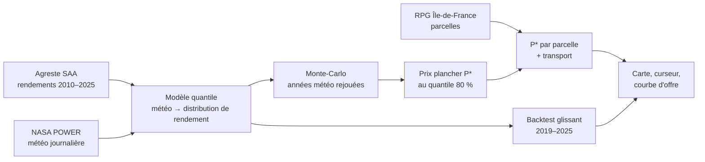

# Le Contrat qui Tient

**Hack the Fork Paris 2026 · Track 3 (souveraineté et filières)**

Le Contrat qui Tient aide le responsable filière d'une coopérative ou d'un conditionneur de légumes secs à fixer **le prix plancher d'un contrat lentille** qui rapporte à l'agriculteur **au moins autant que le blé 8 années sur 10**. L'outil montre aussi **quelles parcelles d'Île-de-France basculent** à ce prix, et combien de tonnes la coopérative peut sécuriser.

> État : projet en cours de construction pendant le hackathon (30 octobre – 1er novembre 2026). Ce README décrit la cible. Ce qui est déjà fait est suivi dans [docs/ROADMAP.md](docs/ROADMAP.md).

---

## Le problème en 30 secondes

- La France veut doubler ses surfaces de légumineuses d'ici 2030, mais importe une grande partie des lentilles qu'elle consomme.
- Les agriculteurs en sèment peu parce que **le rendement de la lentille varie environ deux fois plus que celui du blé** : coefficient de variation national de 0,19 contre 0,09 sur 2010–2025 (**mesuré**, Agreste SAA). Une mauvaise année efface la marge.
- Les coopératives proposent déjà des contrats à prix minimum. Mais ce prix se fixe à l'expérience ou sur des moyennes, alors que c'est **la mauvaise année** qui fait perdre l'agriculteur.

## Ce que fait l'outil

| Entrée | Sortie |
|---|---|
| Territoire (parcelles RPG Île-de-France) | **Prix plancher P\*** calibré sur le risque, par département puis par parcelle |
| Fiabilité visée (80 % par défaut) | **Courbe d'offre** : tonnes mobilisables selon le prix |
| Site de l'acheteur (scénario) | **Carte** des parcelles qui basculent du blé à la lentille |
| Hypothèses de charges et de prix du blé | **Replay** des années 2016 et 2020 |
| | **Score de fiabilité mesuré** sur des années jamais vues par le modèle |
| | **Proposition de contrat** en langage clair, rédigée à partir des chiffres calculés |

## Comment ça marche



1. **Un modèle probabiliste** apprend comment la météo (pluie de printemps, chaleur à la floraison, gel tardif) fait varier les rendements du blé et de la lentille, sur environ 40 départements.
2. **Une simulation Monte-Carlo** rejoue des milliers d'années possibles, et compare dans chacune la marge en lentille sous contrat avec la marge en blé.
3. **Le prix plancher** est le quantile 80 % du prix d'équilibre lentille/blé : au-dessus de ce prix, la lentille gagne dans 80 % des scénarios.
4. **Un backtest sans fuite** vérifie, année par année de 2019 à 2025, si les prix que le modèle aurait fixés auraient vraiment tenu.

Le détail mathématique est dans [docs/MODELE.md](docs/MODELE.md), et l'architecture technique complète dans [docs/ARCHITECTURE.md](docs/ARCHITECTURE.md).

## La suite : de la lentille à la filière

Le projet est pensé en trois temps pour le même utilisateur :

| Temps | Question du responsable filière | Statut |
|---|---|---|
| 1. Avant les semis | « À quel prix je propose le contrat ? » | cœur du hackathon |
| 2. Où collecter | « Où placer mon site de tri pour sécuriser le plus de tonnes ? » | extension prévue |
| 3. Pendant la saison | « Mes parcelles sous contrat poussent-elles bien ? » (suivi Sentinel-2) | extension, puis projet « Le Maillon vu du ciel » |

Voir [docs/ROADMAP.md](docs/ROADMAP.md).

## Démarrage rapide (cible)

```bash
# 1. Pipeline de données et modèle (Python 3.11+)
python -m venv .venv && source .venv/bin/activate
pip install -r requirements.txt
python pipeline/01_agreste.py
python pipeline/02_weather.py
python pipeline/03_yield_model.py
python pipeline/04_backtest.py
python pipeline/05_parcels.py
python pipeline/06_export.py

# 2. Application (Node 20+)
cd app && npm install && npm run dev
```

Tout est **précalculé** en Python et exporté en JSON. Le navigateur ne fait que lire, filtrer et animer : la démo tourne sans connexion.

## Arborescence

```
README.md
pipeline/        scripts numérotés, du téléchargement à l'export JSON
data/            données traitées légères (versionnées)
data_raw/        téléchargements bruts (ignorés par git)
app/             front Vite + React + deck.gl
docs/
  PROJET.md          problème, utilisateur, différenciation, modèle économique
  ARCHITECTURE.md    architecture complète : données, pipeline, front, AWS, LLM
  MODELE.md          spécification du modèle, du Monte-Carlo et du backtest
  ROADMAP.md         étapes, points de décision, extensions, Le Maillon vu du ciel
  DATA_INVENTORY.md  ce que contiennent vraiment les données
  SOURCES.md         chaque source, son statut et sa licence
  LIMITES.md         limites connues et annoncées
  DECLARATIONS.md    ressources préexistantes (obligatoire au dépôt)
  DEMO_SCRIPT.md     script de la démo de 4 minutes
  PITCH_NOTES.md     questions attendues et réponses
  QUESTIONS.md       décisions ouvertes
  maquettes/         maquettes visuelles (données synthétiques)
```

## Étiquetage des chiffres

Chaque chiffre affiché, dans l'application comme dans la documentation, porte l'une de ces étiquettes :

- **mesuré** : donnée officielle (Agreste, RPG, douanes, NASA POWER) ;
- **sourcé** : littérature ou référence technique citée ;
- **supposé** : hypothèse de l'équipe, exposée comme paramètre modifiable ;
- **synthétique / modèle** : produit par une simulation ou un modèle.

## Équipe et licences

Projet réalisé pendant Hack the Fork Paris 2026. Les données utilisées et leurs licences sont listées dans [docs/SOURCES.md](docs/SOURCES.md), et les ressources préexistantes dans [docs/DECLARATIONS.md](docs/DECLARATIONS.md).
