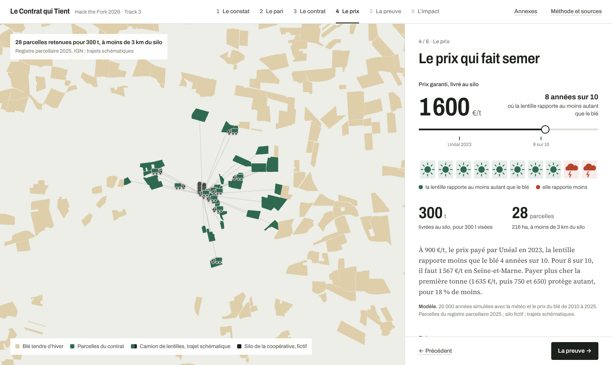
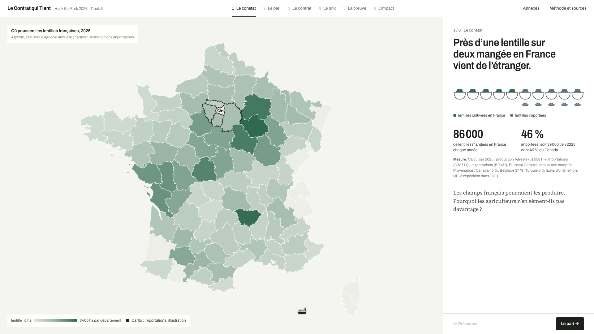
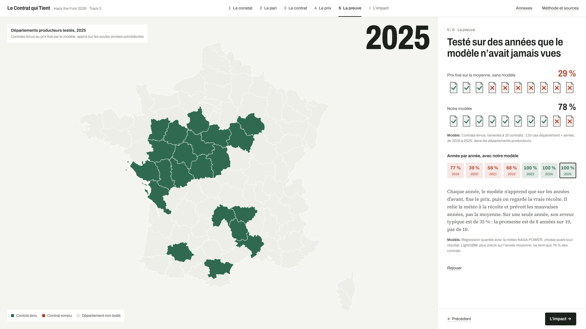
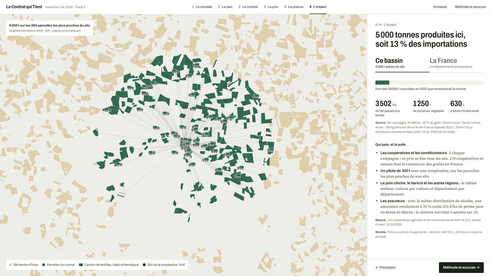
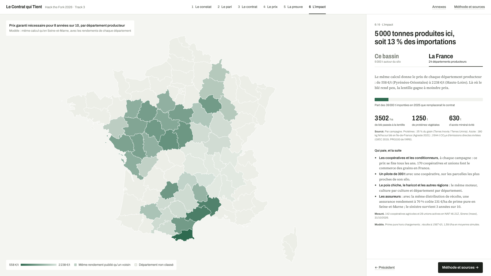
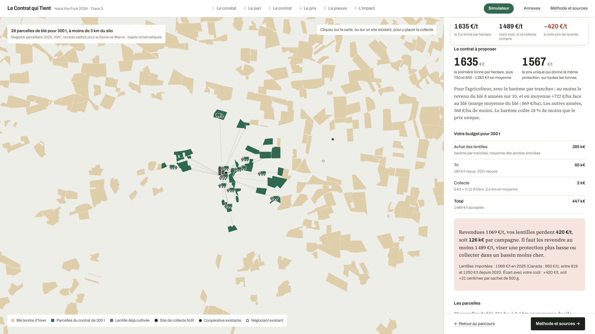
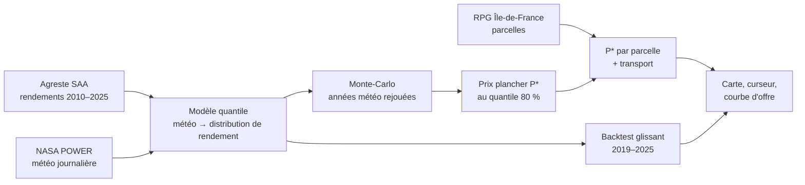

# Le Contrat qui Tient

**Hack the Fork Paris 2026 · Track 3 (souveraineté protéique, des champs français aux protéines de demain)**

**Démo en ligne : https://main.d1lkeu0ybo1cz4.amplifyapp.com/** · **simulateur : https://main.d1lkeu0ybo1cz4.amplifyapp.com/#simulateur** · hors ligne : `make app`, puis ouvrir `app/dist-single/index.html`

Le Contrat qui Tient aide le responsable filière d'une coopérative ou d'un conditionneur de légumes secs à fixer **le prix plancher d'un contrat lentille** qui rapporte à l'agriculteur **au moins autant que le blé 8 années sur 10**. L'outil montre aussi **quelles parcelles d'Île-de-France basculent** à ce prix, et combien de tonnes la coopérative peut sécuriser.

> État (samedi 31/10, soir) : pipeline de bout en bout, tests et démo sur les vraies données (Agreste, RPG 2025, NASA POWER, Eurostat). Scénario économique de la version 4, prix payé sur les tonnes acceptées au tri, comparaison des contrats. La démo suit le pitch de 4 minutes en six écrans animés (le constat, le pari, le contrat, le prix, la preuve, l'impact) ; les écrans détaillés restent en annexes pour les questions. Résultats : [docs/RESULTATS.md](docs/RESULTATS.md).



| | |
|---|---|
|  |  |
|  |  |

Vidéo de la démo, 4 minutes : [docs/video/demo-4min.mp4](docs/video/demo-4min.mp4) ([lien direct](https://github.com/nassim-arifette/hackthefork-hackathon/raw/c4d9aed0fbab8d5895809fcd11e9b52ffdca6ff7/docs/video/demo-4min.mp4)).

## En chiffres

| | |
|---|---|
| Importations de lentilles, 2025 | **39 371 t** (Eurostat Comext) |
| Variabilité du rendement, lentille contre blé | **0,20 contre 0,09** (Agreste, 2010–2025) |
| Aux prix observés de 2012 à 2016 (650 à 779 €/t), la lentille bat le blé francilien | **5 années sur 10** (modèle) |
| Prix plancher pour 8 années sur 10, Seine-et-Marne | **1 567 €/t** départ ferme, sur les tonnes acceptées au tri ; incertitude de 1 099 à 2 877 €/t (modèle) |
| Backtest 2019–2025, années jamais vues | **78 %** de contrats tenus pour 80 % visés, sur 133 cas, contre **29 %** pour un prix calculé sur les moyennes (protocole strict : rien des années testées n'entre dans le calcul) |
| À protection égale, un barème par tranches plutôt qu'un prix unique | **18 % moins cher** en moyenne, 19 % en backtest, où il tient 79 % des contrats contre 78 % (modèle) |
| Pois chiche, haricot, pois, féverole : même moteur | prix fixe tenu dans 65 à 70 % des cas ; **indexé sur le blé, 78 à 89 %** (backtest, après [revue des budgets](docs/REVUE_FILIERE_CULTURES.md)) |
| Ailleurs en France, même calcul | prix nécessaire de **558 à 2 238 €/t** selon les 24 départements producteurs (modèle) |
| Collecte et clients | **352** établissements du commerce de grains à moins de 15 km des parcelles franciliennes ; **142** coopératives agricoles et **28** unions en France (Sirene, mesuré) |

---

## Le problème en 30 secondes

- La France veut doubler ses surfaces de légumineuses d'ici 2030, mais importe une grande partie des lentilles qu'elle consomme.
- Les agriculteurs en sèment peu parce que **le rendement de la lentille varie environ deux fois plus que celui du blé** : coefficient de variation national de 0,20 contre 0,09 sur 2010–2025 (**mesuré**, Agreste SAA). Une mauvaise année efface la marge.
- Les coopératives proposent déjà des contrats à prix minimum. Mais ce prix se fixe à l'expérience ou sur des moyennes, alors que c'est **la mauvaise année** qui fait perdre l'agriculteur.

## Ce que fait l'outil

**Le simulateur** (bouton « Simulateur » de l'application, ou l'adresse `#simulateur`) est l'outil de la responsable filière : elle saisit ses charges, l'aide, la part refusée au tri, la protection visée, le volume, son prix de revente et place son silo ; elle obtient aussitôt le barème à proposer, le prix unique équivalent, le gain de l'agriculteur face au blé, les parcelles à contractualiser, son budget et l'écart avec le prix des lentilles importées. Le calcul est refait dans le navigateur sur les 20 000 années simulées du pipeline : avec les hypothèses du dossier, il retrouve exactement 1 567 €/t et la première tranche à 1 635 €/t.



| Entrée | Sortie |
|---|---|
| Territoire (parcelles RPG Île-de-France) | **Prix plancher P\*** calibré sur le risque, par département puis par parcelle |
| Fiabilité visée (80 % par défaut) | **Courbe d'offre** : tonnes mobilisables selon le prix |
| Site de l'acheteur (scénario) | **Carte** des parcelles qui basculent du blé à la lentille |
| Hypothèses de charges et de prix du blé | **Replay** des années 2016 et 2020 |
| Barèmes de contrat (prix unique, tranches, prime à l'hectare) | **Protection et coût** de chaque barème, publiés ou calibrés |
| Volume visé (pilote 300 t, bassin 5 000 t) | **Proposition de contrat** et **impact** : protéines, azote non apporté, émissions évitées |
| | **Score de fiabilité mesuré** sur des années jamais vues par le modèle |

## Comment ça marche



1. **Un modèle d'apprentissage probabiliste** apprend comment la météo NASA POWER (pluie de printemps, chaleur à la floraison, gel tardif, pluie à la récolte) déplace la distribution des rendements du blé et de la lentille. Deux modèles sont entraînés et comparés : une régression quantile calibrée par conformal prediction (retenue) et un LightGBM quantile (challenger).
2. **Une simulation Monte-Carlo** rejoue 20 000 années : chacune reprend la météo et le prix du blé d'une année réelle, puis compare la marge en lentille sous contrat avec la marge en blé.
3. **Le prix plancher** est le quantile 80 % du prix d'équilibre lentille/blé : au-dessus de ce prix, la lentille gagne dans 80 % des scénarios.
4. **Un backtest sans fuite** vérifie, année par année de 2019 à 2025, si les prix que le modèle aurait fixés auraient vraiment tenu.

Le détail mathématique est dans [docs/MODELE.md](docs/MODELE.md), et l'architecture technique complète dans [docs/ARCHITECTURE.md](docs/ARCHITECTURE.md).

## La suite : de la lentille à la filière

Le projet est pensé en trois temps pour le même utilisateur :

| Temps | Question du responsable filière | Statut |
|---|---|---|
| 1. Avant les semis | « À quel prix je propose le contrat ? » | cœur du hackathon |
| 2. Où collecter | « Où placer mon site de tri pour sécuriser le plus de tonnes ? » | site déplaçable sur la carte, meilleur point d'une grille ou meilleur des 352 établissements existants (Sirene) |
| 3. Pendant la saison | « Mes parcelles sous contrat poussent-elles bien ? Où sont les légumineuses du bassin ? » (Sentinel-2) | prototypes en annexe : replay 2025 sur 8 parcelles ; « Le Maillon vu du ciel » sur 24 km autour du site |

Voir [docs/ROADMAP.md](docs/ROADMAP.md).

## Démarrage rapide

```bash
# 1. Pipeline de données et modèle (Python 3.11+)
python -m venv .venv && source .venv/bin/activate
pip install -r requirements.txt
make export        # 00_prix_commerce → 01_agreste → 02_weather → 03_backtest → 04_parcels → 05_export → 07_contrats → 09_cultures → 11_sites → 06_lettre_llm
make sentinel      # 08_sentinel : NDVI Sentinel-2 de la saison 2025 (réseau, quelques minutes)
make maillon       # 10_maillon : légumineuses repérées par Sentinel-2, RPG 2024 et 2025 (réseau au premier passage)
make sites         # 11_sites : établissements Sirene du commerce de grains (aussi lancé par make export)
# 09_cultures (dans make export) : le même moteur sur pois chiche, haricot, pois et féverole
make test          # données, absence de fuite, propriétés du prix plancher et des contrats, exports

# 2. Application (Node 20+)
make dev           # serveur de développement
make app           # build web (app/dist) et fichier unique hors ligne (app/dist-single)
```

Tout est **précalculé** en Python et exporté en JSON. Le navigateur ne fait que lire, filtrer et animer : la démo tourne sans connexion.

## Arborescence

```
README.md
pipeline/        scripts numérotés, du téléchargement à l'export JSON ; contrats.py, catalogue des contrats comparés
data/            données traitées légères (versionnées) ; pilote_300t/, jeu synthétique du pilote
data_raw/        téléchargements bruts (versionnés, sauf le RPG, retéléchargé par 04_parcels.py)
tools/           générateur reproductible du jeu synthétique du pilote
app/             front Vite + React + deck.gl
docs/
  DOSSIER.md         tout le projet en un document : problème, modèle, données, business, concurrence
  PROJET.md          problème, utilisateur, différenciation, modèle économique
  RESULTATS.md       résultats chiffrés du pipeline
  CONTRAT_SIMULATION.md  barème NatUp reconstitué, contrat synthétique complet, protection calculée
  PILOTE_300T.md     partenaires ciblés et proposition de pilote de 300 t
  DESIGN.md          règles de design de l'application
  FICHE_PROJET.md    fiche projet à déposer
  DECK.md            contenu du deck, slide par slide
  ARCHITECTURE.md    architecture complète : données, pipeline, front, AWS, LLM
  MODELE.md          spécification du modèle, du Monte-Carlo et du backtest
  ROADMAP.md         étapes, points de décision, extensions, Le Maillon vu du ciel
  DATA_INVENTORY.md  ce que contiennent vraiment les données
  SOURCES.md         chaque source, son statut et sa licence
  LIMITES.md         limites connues et annoncées
  DECLARATIONS.md    ressources préexistantes (obligatoire au dépôt)
  PITCH.md           pitch et démo de 4 minutes : texte, gestes, minutage, plan de secours
  PITCH_NOTES.md     questions attendues et réponses
  QUESTIONS.md       réponses de mentor et décisions de l'équipe
  AWS.md             Bedrock et Amplify, pas à pas
```

## Étiquetage des chiffres

Chaque chiffre affiché, dans l'application comme dans la documentation, porte l'une de ces étiquettes :

- **mesuré** : donnée officielle (Agreste, RPG, douanes, NASA POWER) ;
- **sourcé** : littérature ou référence technique citée ;
- **supposé** : hypothèse de l'équipe, exposée comme paramètre modifiable ;
- **synthétique / modèle** : produit par une simulation ou un modèle.

## Équipe et licences

Projet réalisé pendant Hack the Fork Paris 2026. Les données utilisées et leurs licences sont listées dans [docs/SOURCES.md](docs/SOURCES.md), et les ressources préexistantes dans [docs/DECLARATIONS.md](docs/DECLARATIONS.md).
