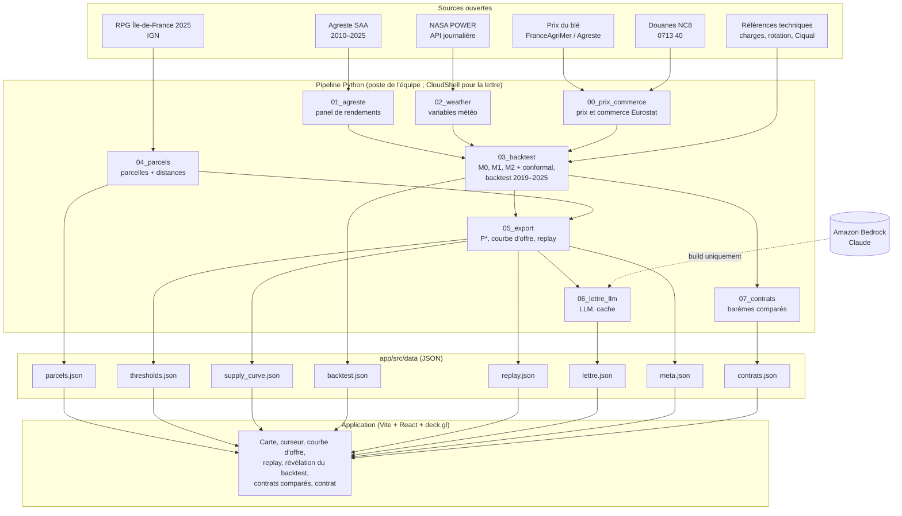
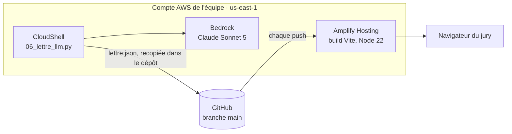

# Architecture

Ce document décrit l'architecture complète : vue d'ensemble, données, pipeline, contrats de données JSON, application, LLM, déploiement AWS, démo hors ligne, sécurité et qualité. La spécification du modèle est dans [MODELE.md](MODELE.md), et les extensions dans [ROADMAP.md](ROADMAP.md).

---

## 1. Principes

1. **Tout est précalculé.** Le pipeline Python produit des fichiers JSON. Le navigateur lit, filtre et anime. Aucun calcul lourd ni appel réseau pendant la démo.
2. **Un seul parcours de démo**, parfait de bout en bout, plutôt que plusieurs à moitié finis.
3. **Chaque chiffre porte son étiquette** : mesuré, sourcé, supposé ou synthétique. L'étiquette voyage avec la donnée jusque dans l'interface.
4. **Aucune fuite temporelle** dans le backtest.
5. **Le LLM ne produit aucun chiffre.** Il rédige autour de chiffres calculés, et ses réponses sont mises en cache au build.
6. **Pas de secret dans le dépôt**, pas de fichier de plus de 100 Mo dans git, pas de donnée personnelle.

---

## 2. Vue d'ensemble



---

## 3. Données

### 3.1 Inventaire et rôle

| Jeu | Rôle | Format | Statut |
|---|---|---|---|
| Agreste SAA 2010–2025, départemental | cible du modèle (blé, lentille) | XLSX, feuille `COP` | **vérifié**, voir [DATA_INVENTORY.md](DATA_INVENTORY.md) |
| NASA POWER | variables météo | API JSON | **vérifié** (requête test OK) |
| RPG Île-de-France 2025 | parcelles candidates, carte | GeoPackage | **vérifié** |
| Douanes NC8 0713 40 | importations (accroche, impact) | CSV | à inspecter |
| Prix du blé 2010–2025 | marge blé | série annuelle | à trouver |
| Charges €/ha blé et lentille | marges | références techniques | à sourcer, sinon supposé |
| Ciqual | protéines de la lentille sèche | CSV | à récupérer |
| ADEME Base Empreinte ou HESTIA | facteurs d'émission | CSV | à récupérer |
| Contours des départements | carte de fond locale | GeoJSON | à récupérer |

### 3.2 Emplacements

```
data_raw/                 téléchargements bruts, jamais versionnés
  agreste/SAA_2010-2025_provisoires_donnees_departementales.xlsx
  nasa_power/<dep>_<annee>.json      cache des réponses API
  rpg/                               archive RPG
  douanes/
data/                     sorties intermédiaires légères, versionnées
  panel_rendements.csv
  meteo_dept.csv
  prix_ble.csv
  hypotheses.yaml          tous les paramètres « supposé », en un seul endroit
  modeles/                 coefficients et quantiles (JSON)
app/public/data/          exports consommés par le front
```

### 3.3 Le fichier d'hypothèses

Toutes les valeurs non mesurées vivent dans `data/hypotheses.yaml`, avec leur étiquette, leur source et leur plage de sensibilité. Le pipeline et l'interface les lisent depuis ce fichier. Extrait :

```yaml
charges_ble_eur_ha:
  valeur: 700
  etiquette: suppose          # mesure | source | suppose | synthetique
  source: "arrondi de 675 €/ha : projection Cerfrance Nord-Est Île-de-France citée par le guide pois Terres Inovia 2025"
  url: "https://www.terresinovia.fr/..."
  sensibilite: [600, 700, 800]
part_non_valorisee:
  valeur: 0.10
  etiquette: suppose
  source: "part de la récolte refusée au tri ; Agreste mesure la récolte au stade arrivée ferme, avant ce tri"
  sensibilite: [0, 0.10, 0.20]
scenario_historique:
  valeur: {charges_ble: 440, charges_lentille: 280, aide: 122, rotation: 0, part_non_valorisee: 0, forfait: 0}
  etiquette: source
```

Un test vérifie que chaque hypothèse porte une étiquette et une source. Les barèmes de contrat comparés vivent à part, dans `data/pilote_300t/contrats.json`.

---

## 4. Pipeline

Chaque script est indépendant, idempotent, lit ses entrées depuis le disque et écrit ses sorties. On peut relancer une étape sans relancer les autres.

> Implémentation actuelle : `00_prix_commerce` (Eurostat : prix du blé, prix de la lentille, commerce Comext), `01_agreste`, `02_weather`, `03_backtest` (modèles et backtest, code partagé dans `model.py`), `04_parcels`, `05_export` (modèle final, P\*, sensibilités, bootstrap, exports), `07_contrats` (barèmes publiés, proposition du dossier pilote, tranches et prime calibrées ; catalogue dans `contrats.py`, formules dans `model.py`), `06_lettre_llm` (Bedrock, facultatif), `08_sentinel` (NDVI Sentinel-2 de la saison 2025, prototype de suivi ; `make sentinel`), `09_cultures` (le même moteur sur le pois chiche, le haricot, le pois et la féverole ; météo de 87 départements dans `meteo_dept_cultures.csv`, hypothèses dans `data/cultures.yaml`), `10_maillon` (légumineuses repérées par Sentinel-2 sur 24 km autour du site, RPG 2024 et 2025, LightGBM validé par carrés de 4 km et d'une année à l'autre ; `make maillon`), `11_sites` (établissements Sirene du commerce de grains autour de l'Île-de-France, meilleur site existant par volume, distance des légumineuses du Maillon à la collecte, nombre de coopératives en France ; `make sites`). Le site de collecte se déplace dans le navigateur : distances, prix rendu et courbe d'offre y sont recalculés avec les formules de `05_export`. Les exports sont écrits dans `app/src/data/` et inclus dans le build. `make test` lance les tests : données, absence de fuite, prix plancher, contrats, exports. Le tableau ci-dessous décrit le découpage initial.

| Script | Entrées | Sorties | Points d'attention |
|---|---|---|---|
| `00_inventory.py` | zips de `data_raw/` | `docs/DATA_INVENTORY.md` (section générée) | lancer avec `python -I`, extraire dans un dossier dédié |
| `01_agreste.py` | XLSX SAA | `data/panel_rendements.csv` | en-tête à la ligne 6 ; filtres surface ≥ 50 ha et statut 1–2 ; regroupement des séries identiques |
| `02_weather.py` | panel (liste des départements), centroïdes | `data/meteo_dept.csv`, cache `data_raw/nasa_power/` | pause entre requêtes, reprise sur erreur, cache par département |
| `03_yield_model.py` | panel + météo | `data/modeles/*.json` | M0, M1, M2 ; quantiles 0,1 / 0,5 / 0,9 ; conformal temporel |
| `04_backtest.py` | panel + météo + prix | `app/public/data/backtest.json` | réentraînement à chaque année test ; protocole figé |
| `05_parcels.py` | RPG | `app/public/data/parcels.geojson` | filtre blé tendre d'hiver ; reprojection Lambert-93 → WGS84 ; simplification ; distance au site |
| `06_export.py` | modèles + parcelles + hypothèses | `thresholds.json`, `supply_curve.json`, `replay.json`, `meta.json` | Monte-Carlo, P\* départemental puis par parcelle |
| `07_contract_texts.py` | exports + hypothèses | `contract_texts.json` | Bedrock, pauses ≥ 1 s, cache, vérification des chiffres |

### Dépendances Python

pandas, numpy, openpyxl, scikit-learn, lightgbm, statsmodels, geopandas, pyogrio, shapely, pyproj, requests, pyyaml, boto3 (étape 07 uniquement). Les versions exactes sont figées dans `requirements.txt` au moment de l'installation.

### Orchestration

Un `Makefile` enchaîne les étapes : `make data`, `make model`, `make backtest`, `make export`, `make app`. Chaque cible ne se relance que si ses entrées ont changé.

---

## 5. Contrats de données (JSON)

Ces schémas sont le contrat entre le pipeline et le front. Les deux côtés peuvent avancer en parallèle : le front démarre sur des fichiers synthétiques au bon format.

### `meta.json`

```json
{
  "genere_le": "2026-10-31T14:00:00Z",
  "fiabilite_visee": 0.8,
  "hypotheses": { "charges_lentille_eur_ha": { "valeur": 0, "etiquette": "suppose", "source": "" } },
  "sources": [{ "id": "agreste_saa", "libelle": "Agreste SAA 2010–2025", "etiquette": "mesure" }],
  "synthetique": false
}
```

### `parcels.geojson`

FeatureCollection en WGS84, coordonnées arrondies à 5 décimales (environ 1 m).

```json
{
  "type": "Feature",
  "geometry": { "type": "Polygon", "coordinates": [[[2.95, 48.6], [2.951, 48.6], [2.951, 48.601], [2.95, 48.6]]] },
  "properties": {
    "id": "77-000123",
    "dep": "77",
    "surface_ha": 12.4,
    "dist_km": 18.2,
    "p_star_dep": 0,
    "p_star_rendu": 0,
    "tonnes_attendues": 0
  }
}
```

`p_star_rendu` est le prix rendu au-dessus duquel la parcelle bascule. Le front compare directement le curseur à cette valeur.

### `thresholds.json`

```json
{
  "par_departement": [
    { "dep": "77", "p_star": 0, "ic80": [0, 0], "rendement_lentille_q50": 0, "etiquette": "modele" }
  ],
  "sensibilite": {
    "fiabilite": [{ "tau": 0.5, "p_star_77": 0 }, { "tau": 0.95, "p_star_77": 0 }],
    "prix_ble": [{ "scenario": "bas", "p_star_77": 0 }]
  }
}
```

### `supply_curve.json`

```json
{ "prix_rendu": [450, 455, 460], "tonnes": [0, 120, 340], "hectares": [0, 80, 230], "etiquette": "modele" }
```

### `backtest.json`

```json
{
  "protocole": "glissant, entraînement sur années < t, calibration conformal sur les 3 dernières",
  "annees": [
    { "annee": 2020, "n_dep": 30, "contrats_tenus": 0, "couverture_ic80": 0, "pinball_m1": 0, "pinball_m0": 0 }
  ],
  "global": { "taux_tenus": 0, "couverture_ic80": 0, "gain_pinball_vs_baseline": 0 },
  "detail": [
    { "annee": 2020, "dep": "10", "p_star": 0, "y_lentille_reel": 0, "ic80": [0, 0], "tenu": false }
  ]
}
```

### `replay.json`

```json
{
  "annees": [
    { "annee": 2016, "choc_ble": -0.27, "choc_lentille": -0.13, "etiquette": "mesure",
      "par_parcelle": { "77-000123": { "facteur_ble": 0.72, "facteur_lentille": 0.88, "tenu": true } } }
  ]
}
```

### `contract_texts.json`

```json
{
  "modele_llm": "identifiant Bedrock exact",
  "genere_le": "2026-10-31T20:00:00Z",
  "textes": [{ "cle": "77_640_0.8", "entrees": { "p_star": 0, "tonnes": 0 }, "texte": "", "chiffres_verifies": true }]
}
```

---

## 6. Application

### 6.1 Pile technique

- **Vite + React + TypeScript** ;
- **deck.gl** pour la carte : `GeoJsonLayer` (France, départements) et `PolygonLayer` plan pour les 20 922 parcelles, transitions de couleur sur GPU ;
- polices intégrées au build (Fontsource) : la version hors ligne est identique à la version en ligne ;
- graphiques en SVG maison ou **Observable Plot** (courbe d'offre, frise du backtest) ;
- état global minimal : prix, année de replay, étape de démo, parcelle sélectionnée ;
- **aucun fond de carte en ligne** : contours des départements en GeoJSON local.

### 6.2 Composants

```
app/src/
  main.tsx
  App.tsx                 routeur d'étapes (bascule → replay → backtest → contrat)
  data/load.ts            chargement et validation des JSON (schémas ci-dessus)
  state/store.ts          prix, année, étape, sélection
  components/
    MapView.tsx           deck.gl : parcelles extrudées, site acheteur, contours
    PriceSlider.tsx       curseur €/t, raccourcis clavier ← →
    BigCounter.tsx        compteur animé de tonnes et d'hectares
    SupplyChart.tsx       courbe d'offre + point courant
    ReplayPanel.tsx       2016 / 2020 : chocs mesurés, verdicts par parcelle
    BacktestReveal.tsx    frise 2019–2025, bande d'incertitude puis point réel
    ContractCard.tsx      texte du contrat depuis le cache
    SourceBadge.tsx       étiquette mesuré / sourcé / supposé / synthétique
    HypothesesDrawer.tsx  paramètres et sensibilités
  styles/tokens.css
```

### 6.3 Direction visuelle

Règles complètes, jetons et interdits : [DESIGN.md](DESIGN.md). En résumé : un atlas agricole clair et plan, Archivo pour les titres et les chiffres, Source Serif 4 pour le texte, deux couleurs sémantiques (ocre pour le blé, vert lentille), le rouge réservé au contrat non tenu, des lignes de source comme des crédits de presse, des graphiques à étiquettes directes. Parcours guidé en cinq étapes : le verrou, le prix, l'épreuve, la preuve, le contrat.

### 6.4 Performance

| Budget | Cible |
|---|---|
| Parcelles affichées | ≤ 30 000 polygones |
| Taille de `parcels.geojson` | ≤ 10 Mo (simplification, 5 décimales) |
| Fréquence d'affichage pendant la bascule | 60 images/s sur un laptop moyen |
| Premier affichage | < 2 s depuis le disque |

Si la limite est dépassée : restreindre à une zone de démo (rayon autour du site acheteur), ou fusionner les petites parcelles voisines.

### 6.5 Raccourcis de démo

Le présentateur ne doit jamais chercher un bouton : `Espace` passe à l'étape suivante (`Maj + Espace` pour revenir), `←` et `→` déplacent le prix, `1` et `2` choisissent l'année à l'étape « L'épreuve », `F` montre la carte de France à l'écran 6, `M` ouvre la méthode, `Échap` la ferme.

---

## 7. LLM

- **Rôle** : rédiger la proposition de contrat et une explication courte du résultat, à partir de chiffres fournis.
- **Modèle** : Claude Sonnet 5 sur Amazon Bedrock (us-east-1), Claude Haiku 4.5 pendant les itérations. Les identifiants exacts sont récupérés avec `aws bedrock list-foundation-models --region us-east-1`, jamais devinés.
- **Appel au build uniquement** (`07_contract_texts.py`) : la démo lit `contract_texts.json` et ne dépend pas du réseau.
- **Garde-fou sur les chiffres** : après génération, on extrait tous les nombres du texte et on vérifie qu'ils figurent dans les entrées. Un texte qui contient un nombre inconnu est rejeté et régénéré.
- **Quota** : environ 1 requête par seconde et par personne. Pause d'au moins 1 s entre appels, réessai avec attente croissante, cache par clé `(département, prix, fiabilité)`.

Gabarit de requête :

```
Tu rédiges une proposition de contrat lentille pour une coopérative.
Utilise uniquement les chiffres fournis ci-dessous. N'en invente aucun, n'en arrondis aucun.
Chiffres : {json des entrées}
Structure : objet du contrat, prix plancher, durée, volume visé, ce que garantit le prix (et ce qu'il ne garantit pas), clause de révision.
Ton : clair, factuel, destiné à un agriculteur.
```

---

## 8. Déploiement AWS



| Service | Usage |
|---|---|
| Amplify Hosting | build et hébergement de l'application à chaque push sur `main` (`amplify.yml` : dossier `app`, Node 22, sortie `dist`) |
| CloudShell | exécution de la seule étape qui appelle Bedrock ; droits du compte déjà configurés |
| Bedrock | rédaction de la lettre d'accompagnement à partir des chiffres exportés ; un nombre absent de ces chiffres fait rejeter le texte |

Le pipeline de données tourne sur le poste de l'équipe : il ne demande ni GPU ni service AWS. S3 et SageMaker, prévus au départ, ne sont pas nécessaires. Contraintes du compte : us-east-1 uniquement, compte supprimé 72 h après le début de l'événement. L'URL Amplify disparaît avec le compte : la démo de secours est donc locale. Marche à suivre : [AWS.md](AWS.md).

---

## 9. Démo sur l'ordinateur commun

Trois niveaux de secours, testés dimanche entre 8h30 et 10h :

1. **URL Amplify**, en favori.
2. **Fichier HTML unique** construit avec `vite-plugin-singlefile`, données incluses, sur clé USB. Il s'ouvre sans serveur ni internet.
3. **Vidéo de la démo**, deux prises, sur clé USB.

Jamais d'éditeur de code ni de terminal à l'écran pendant le pitch.

---

## 10. Sécurité et conformité

- Aucune clé, aucun jeton, aucun identifiant dans le dépôt. Les identifiants AWS restent dans l'environnement local (`aws configure` ou variables d'environnement).
- Uniquement des données ouvertes, anonymisées ou synthétiques. Le RPG ne contient pas d'identifiant d'exploitant [à vérifier sur la version fournie].
- Les archives téléchargées sont traitées comme non fiables : extraction dans un dossier dédié, scripts lancés avec `python -I`.
- Toute ressource préexistante est déclarée dans [DECLARATIONS.md](DECLARATIONS.md).

---

## 11. Qualité et tests

| Test | Ce qu'il vérifie |
|---|---|
| `test_panel.py` | pas de doublon département × année × culture ; unités en q/ha ; années 2010–2025 |
| `test_no_leakage.py` | pour chaque année test, aucune ligne de l'année test ni des suivantes dans l'entraînement |
| `test_p_star.py` | P\* croît avec τ ; P\* croît avec le prix du blé ; P\* = quantile des prix d'équilibre |
| `test_exports.py` | chaque JSON respecte son schéma ; chaque chiffre a une étiquette |
| `test_llm_numbers.py` | aucun nombre du texte généré absent des entrées |
| Vérification front | `npm run build` sans erreur ; capture d'écran automatique des étapes de démo (Playwright) |

---

## 12. Organisation du travail

| Rôle | Périmètre |
|---|---|
| Données et modèle | scripts 01 à 04, `MODELE.md` |
| Géo et export | scripts 05 et 06, hypothèses |
| Front | `app/`, direction visuelle, démo hors ligne |
| Agro et pitch | hypothèses de charges et de rotation, sources, deck, répétitions |

Le contrat de données de la section 5 permet aux quatre rôles d'avancer en parallèle dès le vendredi soir.
