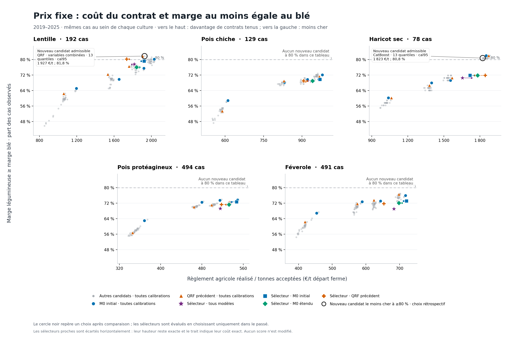

# Nouvelles données et optimisation du prix contractuel

**Les 36 configurations ont été exécutées et vérifiées, avec les mêmes cas et le même profil numérique. L'ajout de données NASA, SIM, sols et RPG ne bat pas le QRF saisonnier précédent pour la lentille à prix fixe.** Le meilleur candidat à calibration fixée dans cette grille reste `qrf_seasonal/cal95` : **157/192 contrats tenus (81,77 %), à 1 907 €/t acceptée**, contre **154/192 (80,21 %), à 2 031 €/t** pour la vraie baseline M0 avec le même calibrage.

Une amélioration différente apparaît dans la décision : **conserver ce QRF et choisir sa calibration sur les seules années passées** donne **154/192 (80,21 %), à 1 762 €/t**, contre **152/192 (79,17 %), à 1 891 €/t** pour le sélecteur M0. En revanche, le sélecteur qui peut changer entre les 36 modèles reste à **77,60 %**. L'élargissement du choix ne produit donc pas automatiquement une meilleure politique.

Pour les autres cultures, CatBoost propose un compromis moins cher en haricot fixe ; le sélecteur étendu apporte un gain de coût à protection globale égale en pois et pois chiche **indexés**. Aucun candidat fixe testé dans cette grille n'atteint 80 % pour pois, pois chiche ou féverole. Les tableaux ci-dessous conservent les pertes et les sous-groupes où les enrichissements ne fonctionnent pas.

Travaux publiés dans la [PR #5](https://github.com/nassim-arifette/hackthefork-hackathon/pull/5), basée sur la PR #4. Les archives sont dans le [dossier Drive de cette itération](https://drive.google.com/drive/folders/1_po5W-5yhaKCB8d0-NAaNU0ZfdnIqnvf). Les raisons scientifiques des expériences et les articles primaires sont détaillés dans [RECHERCHE_DONNEES_MODELES.md](RECHERCHE_DONNEES_MODELES.md).

## L'objectif évalué

Le produit recherche **le prix départ ferme minimal pour que la légumineuse rapporte au moins autant que le blé à l'hectare dans 80 % des années simulées**. L'égalité des marges compte comme un contrat tenu. Le prix est fixé avant la campagne ; la météo réalisée pendant l'année test ne sert pas à le choisir.

Dans le scénario économique post-PR #3, le rendement payé est celui accepté après le taux de refus fixé par culture. Le calcul inclut les charges, l'aide couplée et le crédit de rotation retenus dans les fichiers d'hypothèses :

\[
M_L=P_LY_{L,\mathrm{accepté}}-C_L+A_L+R_L,\qquad
M_B=P_BY_B-C_B.
\]

Le prix d'équilibre d'un scénario est `(P_B × Y_B − C_B + C_L − A_L − R_L) / Y_L_accepté`. Le prix minimal non négatif est le quantile empirique 80 % de ces prix, borné à zéro. Les besoins de revenu négatifs sont conservés dans le calcul ; aucune transformation en valeur absolue ne les rend artificiellement positifs.

Les 20 000 scénarios par cas rejouent une année météo/prix du blé historique, avec les aléas de rendement du modèle. **Le seuil simulé de 80 % et le taux de contrats tenus sur les observations laissées de côté sont deux mesures différentes.** Le backtest évalue si les marges réellement observées satisfont le contrat proposé avant de les connaître.

Le coût principal est **la somme des règlements agricoles divisée par la somme des tonnes acceptées**. Ce n'est pas la moyenne arithmétique des prix départementaux. Chaque cas département–année représente ici un hectare type ; le tableau n'est pas pondéré par les surfaces agricoles nationales. Transport et tri n'entrent pas dans cette métrique de paiement départ ferme. Les contrats indexés et par tranches sont également calculés, mais un gain dû à l'indexation ne sera pas attribué au seul modèle de rendement.

## Ce qui a été récupéré

| Source effectivement utilisée | Volume et couverture | Transformation |
|---|---|---|
| NASA POWER, cache quotidien existant | 87 départements, 2010–2025, **1 392 lignes annuelles** | Aux six variables historiques et cinq saisonnières par culture s'ajoutent **14 variables par culture** : séquences sèches/humides, pluie maximale sur cinq jours, concentration des pluies, séquences chaudes, degrés-jours, fenêtres décalées et pluie antérieure. |
| **Météo-France SIM décadaire**, et non le produit quotidien | **1 392 lignes**, huit indicateurs pour chacune des cinq légumineuses et pour le blé | Moyennes d'humidité, déficit climatique, ratio d'évapotranspiration réelle/potentielle, pluie de récolte. Les mailles de 8 km sont agrégées par surface départementale, puis dans une seconde version par fractions agricoles **CLC 2012**. |
| **INRAE BDGSF/SAFRAN**, [DOI 10.57745/1PDFNL](https://doi.org/10.57745/1PDFNL) | GeoPackage de 3,36 Mo, publié en **2022** ; sept caractéristiques de sol pour les 87 départements | Moyenne, dispersion et quantiles 10/90 de réserve utile, profondeur, capacité au champ et point de flétrissement. Pondération par intersection département–maille et classes CLC 211, 241 et 242. |
| **IGN/ASP RPG 2015** | **58 285 parcelles** téléchargées ; **286 groupes département × culture** pour quatre cultures | Les hectares déclarés pondèrent les sols puis, dans deux expériences supplémentaires, les variables SIM par culture. Le masque de 2015 est fixe ; aucune rotation annuelle ou parcelle 2025 n'est inférée. |

La variante RPG n'a pas de masque observé pour le haricot dans cette extraction : aucun enregistrement `PHS` n'a été renvoyé. Elle reprend les valeurs agricoles CLC pour le haricot et pour les autres groupes absents. Le modèle de sol par culture reçoit un indicateur de ce repli ; les variantes météo RPG conservent exactement les valeurs CLC des groupes sans masque.

Le [raster de réserve utile haute résolution DOI 10.15454/9IRARJ](https://doi.org/10.15454/9IRARJ), de 644 Mo, est public et joignable. Son transfert n'a pas été retenu après un essai de 1 Mio prenant environ 37 secondes. **Ce raster n'est pas utilisé** ; le GeoPackage INRAE effectivement téléchargé fournit l'alternative réelle. Aucun champ de sol n'a été inventé pour remplacer le téléchargement.

Sources et empreintes : [météo avancée](../data/meteo_advanced_manifest.json), [SIM territorial](../data/sim_manifest.json), [SIM agricole CLC](../data/sim_agri_manifest.json), [sols et parcelles RPG](../data/soil_manifest.json), [SIM pondéré par RPG](../data/sim_rpg_manifest.json).

## Nettoyage et preprocessing

| Étape | Traitement exécuté |
|---|---|
| Rendements Agreste | Conversions numériques explicites ; surface ≥50 ha, rendement positif, statuts qualité 1 ou 2. Les observations écartées ne sont pas remplacées par des rendements synthétiques. |
| Séries départementales en double | Regroupement à partir des seules années disponibles avant le pli : au moins huit rendements annuels identiques à 0,01 q/ha près ; représentant choisi selon la surface moyenne passée. |
| Cohorte | Au moins trois mesures passées par département représentant ; même intersection avec le blé pour tous les candidats. Les variables enrichies ne créent pas de nouveaux labels de rendement. |
| Météo quotidienne | Détection des marqueurs manquants, validation de tous les jours, de l'ordre Tmin/Tmax et des précipitations non négatives. Pas de remplissage silencieux d'une année incomplète. |
| Météo SIM | Contrôle des 36 décades par maille et de la couverture spatiale ; flux répartis au prorata des jours recoupant une phase et moyennes pondérées par les jours. Les jours de faible humidité restent un proxy décadaire. |
| Cible rendement | Division par la moyenne départementale passée. Une variante rapproche ce niveau du niveau régional avec le poids `n/(n+5)`, puis restitue le niveau lors de la simulation. |
| Variables dynamiques | Anomalies par rapport à la moyenne passée du département, standardisation avec l'historique. Une variante conserve aussi les valeurs absolues standardisées. |
| Variables statiques de sol | Standardisation globale sur l'entraînement, dans un bloc séparé. Elles ne sont pas centrées au sein du département, ce qui les annulerait. |
| Phases culturales | Fenêtres calendaires et seuils fixés avant l'exécution ; ils constituent des indicateurs agronomiques exploratoires, pas des dates de semis ou de floraison observées. |

La pluie dite antérieure couvre le début de l'année jusqu'à la phase végétative. Elle ne reconstitue pas un hiver complet avec décembre 2009, absent du cache. Le déficit climatique `ETP − pluie` est un indicateur ; il n'est pas présenté comme un bilan hydrique de culture complet incluant irrigation et enracinement.

## Les 36 configurations et leurs références

**34 configurations principales + deux variantes météo RPG exécutées séparément**, soit 1 800 blocs culture–année–configuration sur cinq cultures et dix années. Les prédictions 2016–2018 amorcent la calibration, la sélection et les dépendances ; l'évaluation principale est **2019–2025**.

| Bloc principal | Nombre | Question posée |
|---|---:|---|
| M0 original et QRF saisonnier précédent | 2 | Reproduire les références avant de mesurer un changement. |
| M0 dense et deux dépendances | 3 | Les améliorations de simulation profitent-elles aussi à la vraie baseline ? |
| Variables/données QRF, trois et 13 quantiles | 8 | Union des variables ; séquences NASA ; SIM ; sols : quelle contribution de chaque bloc ? |
| Préparation QRF | 2 | Apport des niveaux météo absolus et de la régularisation département–région. |
| Réglages QRF | 6 | Taille des feuilles, profondeur et fraction de variables. |
| LightGBM | 3 | Trois/13 quantiles et réglage alternatif feuilles/profondeur/arbres. |
| CatBoost | 3 | Trois/13 quantiles et réglage alternatif profondeur/itérations/régularisation. |
| Mélange QRF–LightGBM | 1 | Mélange 50/50 de distributions, plutôt que moyenne des quantiles. |
| Dépendances QRF | 2 | Résidus indépendants, copule gaussienne ou empirique en damier. |
| SIM agricole CLC | 2 | Météo des surfaces agricoles versus moyenne de tout le département. |
| Sol pondéré par culture RPG | 1 | Sol des parcelles de la culture, avec repli explicite si absent. |
| Modèle du blé enrichi | 1 | Améliorer aussi la distribution du rendement servant de comparaison économique. |
| **Extension SIM pondéré par culture RPG** | **2** | Même QRF agricole, mais variables SIM pondérées par les parcelles 2015, en trois et 13 quantiles. |

**M0 est la tendance linéaire des rendements relatifs avec quantiles empiriques de résidus.** Ce n'est pas un QRF avant optimisation. Les tableaux conservent M0 original et le QRF saisonnier de la PR #4. Les variantes `trend_dense`, `trend_joint_gaussian` et `trend_joint_empirical` forment en outre une famille M0 à simulation étendue.

Les variantes denses utilisent les quantiles `1, 5, 10, 20, 30, 40, 50, 60, 70, 80, 90, 95, 99 %`, avec interpolation, queues linéaires et plancher commun de rendement relatif 0,02. La copule gaussienne utilise une corrélation de résidus passés hors entraînement, réduite par `n/(n+30)`, bornée à ±0,8 ; moins de 20 paires impose l'indépendance. La copule empirique utilise les rangs de paires historiques, avec tirage uniforme dans chaque cellule. Ces choix sont des hypothèses testées, pas des dépendances supposées connues.

L'espace de réglages est une **grille finie prédéfinie** sur QRF, LightGBM et CatBoost. L'apprentissage direct du prix d'équilibre et un nouveau test entraîné en excluant une région entière ne font pas partie de cette exécution. Les résultats régionaux sont des sous-groupes du test temporel, pas une validation de transfert vers une région jamais vue.

## Protocole temporel et coût comparable

Pour une décision en année `t`, le modèle, ses moyennes, les représentants Agreste et la préparation utilisent uniquement les années `< t`. Le contrat rejoue uniquement des années météo/prix `< t`, en appliquant la tendance de l'année cible. Le prix du blé et la météo proviennent de la même année historique ; les candidats partagent les tirages Monte-Carlo.

Les diagnostics utilisant la météo réalisée de l'année test évaluent les distributions de rendement **après récolte**. Ils n'entrent pas dans le prix pré-saison. De même, la dépendance d'une année est figée avant de lire les résultats de ses départements : les premiers cas d'une année ne peuvent pas influencer les derniers.

Les politiques sont `raw`, `cal80`, `cal90` et `cal95`. Les trois dernières ajoutent au prix/coefficient une correction non négative issue du quantile correspondant des erreurs des **trois années passées hors entraînement**. `cal95` désigne le quantile de correction, **pas un objectif produit de 95 %**. Le seuil du produit reste 80 % et la procédure est identique pour M0 et ses concurrents.

Quatre sélecteurs sont comparés avec la même règle et la même fenêtre passée :

- `all_models` choisit parmi tous les modèles et calibrations disponibles ;
- `m0_only` choisit seulement la calibration de M0 original ;
- `m0_extended` peut aussi choisir ses variantes de distribution et de dépendance ;
- `qrf_reference` choisit seulement la calibration du QRF saisonnier précédent.

Le sélecteur retient le coût réalisé par tonne acceptée le plus bas parmi les candidats atteignant 80 % sur sa validation passée. Si aucun ne satisfait le seuil, il retient le meilleur taux passé et consigne ce repli. **Le résultat de ce sélecteur temporel est distinct de celui du meilleur candidat identifié après lecture du tableau complet.**

Le test conserve les mêmes cas pour chaque comparaison. Les gains sont publiés avec les cas sauvés et perdus, le déficit moyen, les coûts et des intervalles descriptifs obtenus par rééchantillonnage d'années entières. Les pertes quantiles de rendement en t/ha servent au diagnostic ; les pertes sur rendements relatifs ne sont pas directement comparables entre normalisations différentes.

| Culture | Cas 2016–2025, amorçage compris | Cas évalués 2019–2025 | Cas 2023–2025 |
|---|---|---|---|
| Lentille | 274 | 192 | 75 |
| Haricot sec | 108 | 78 | 33 |
| Pois chiche | 165 | 129 | 56 |
| Pois protéagineux | 718 | 494 | 205 |
| Féverole | 699 | 491 | 216 |

Les **1 964 cas** incluant l'amorçage correspondent à **1 384 observations évaluées sur sept années**. La sensibilité récente contient **585 cas sur trois années**. Les effectifs sont identiques entre les 36 configurations et les trois formes contractuelles. Le nombre de lignes de simulation ou de politiques ne constitue pas un nombre supplémentaire de récoltes observées.

## Prix fixe : résultat final sur les mêmes cas

Le candidat ci-dessous minimise le paiement par tonne acceptée **parmi les configurations à calibration fixée atteignant 80 % dans le tableau final**. Lorsqu'aucune n'atteint ce seuil, le tableau indique explicitement le meilleur taux observé. Ce classement est rétrospectif ; les coefficients annuels ont été calculés avant la récolte, mais le choix final de la ligne s'appuie sur les résultats 2019–2025. Le sélecteur temporel est évalué séparément.

| Culture | Candidat de la grille | Tenu / cas · taux · €/t | Déficit moyen €/ha | M0 cal95 : taux et coût | QRF précédent cal95 : taux et coût | Statut |
|---|---|---|---|---|---|---|
| Lentille | `qrf_seasonal/cal95` | 157/192 · 81,77 % · 1 907 € | 34,80 | 154/192 · 80,21 % · 2 031 € | 157/192 · 81,77 % · 1 907 € | ≥80 % |
| Haricot sec | `cat_dense/cal95` | 63/78 · 80,77 % · 1 823 € | 83,32 | 64/78 · 82,05 % · 1 852 € | 64/78 · 82,05 % · 1 873 € | ≥80 % |
| Pois chiche | `qrf_combined_dense/cal95` | 94/129 · 72,87 % · 961 € | 70,27 | 93/129 · 72,09 % · 979 € | 92/129 · 71,32 % · 967 € | **Sous 80 %** |
| Pois protéagineux | `trend_dense/cal95` | 366/494 · 74,09 % · 551 € | 71,06 | 364/494 · 73,68 % · 549 € | 358/494 · 72,47 % · 532 € | **Sous 80 %** |
| Féverole | `qrf_rpg_weather_dense/cal95` | 378/491 · 76,99 % · 701 € | 67,97 | 373/491 · 75,97 % · 717 € | 376/491 · 76,58 % · 698 € | **Sous 80 %** |

Sur lentille, le QRF saisonnier tient **trois cas supplémentaires et n'en perd aucun** face à M0/cal95, avec **−6,12 % de paiement** et **−15,50 % de déficit moyen**. L'intervalle descriptif obtenu en rééchantillonnant les sept années entières pour l'écart de coût est **[−264 ; +20] €/t**. Il décrit la sensibilité aux années de ce test, pas une probabilité de gain futur.

Sur haricot, `cat_dense/cal95` réduit le coût de **1,55 %** face à M0/cal95 et de **2,68 %** face au QRF/cal95, mais perd **un contrat** face à chacun. Son déficit moyen est plus élevé : **83,32 contre 64,46 €/ha pour M0**, et **72,83 €/ha pour QRF**. CatBoost est donc le moins cher au-dessus du seuil dans cette grille, tandis que M0 conserve davantage de protection. La décision commerciale doit choisir ce compromis explicitement.

Les 36 configurations réexécutent M0 et le QRF **saisonnier** de référence ; elles ne réexécutent pas toutes les autres lignes de la PR #4, notamment M1 historique et le QRF à six anciennes variables. Les meilleurs taux fixes antérieurs de M1 pois chiche (**73,64 %**) et du QRF historique féverole (**77,60 %**) restent supérieurs aux meilleurs taux de cette nouvelle grille, tout en restant sous l'objectif. Les nouveaux essais ne les remplacent pas par simple préférence pour un modèle enrichi.

### Choisir chaque année avec les seules années précédentes

Chaque cellule indique **taux de contrats tenus ; paiement €/t acceptée**. Les quatre sélecteurs utilisent la même règle économique et la même fenêtre passée. Ils changent éventuellement de calibration ; seul `all_models` peut choisir librement dans l'ensemble des 36 configurations.

| Culture | Tous modèles | M0 original | Famille M0 étendue | QRF précédent |
|---|---|---|---|---|
| Lentille | 77,60 % ; 1 793 € | 79,17 % ; 1 891 € | 76,04 % ; 1 875 € | 80,21 % ; 1 762 € |
| Haricot sec | 70,51 % ; 1 730 € | 71,79 % ; 1 754 € | 71,79 % ; 1 755 € | 71,79 % ; 1 758 € |
| Pois chiche | 68,99 % ; 922 € | 69,77 % ; 963 € | 68,99 % ; 948 € | 68,99 % ; 920 € |
| Pois protéagineux | 69,23 % ; 516 € | 72,67 % ; 538 € | 71,26 % ; 533 € | 71,26 % ; 527 € |
| Féverole | 69,04 % ; 683 € | 73,12 % ; 712 € | 72,10 % ; 707 € | 71,69 % ; 653 € |

**Seul le sélecteur limité au QRF précédent en lentille fixe atteint 80 %** parmi ces vingt politiques automatiques : **154/192, 1 761,57 €/t, déficit 38,86 €/ha**. Face au sélecteur M0 original : **deux cas sauvés, aucun perdu, −6,84 % de paiement et −8,29 % de déficit**. Son coût est inférieur de 7,62 % à la calibration fixée QRF/cal95, avec trois contrats tenus de moins ; ce n'est donc pas une amélioration de toutes les métriques. L'intervalle descriptif annuel de l'écart de coût face au sélecteur M0 est **[−255 ; +7] €/t**.

Le sélecteur tous-modèles en lentille tient **149/192**, coûte **1 793 €/t** et présente **44,56 €/ha** de déficit moyen : il ne justifie pas l'activation automatique des nouveaux enrichissements pour l'offre fixe. Les autres cultures restent également sous 80 % avec les quatre sélecteurs fixes. Les décisions et tous les candidats disponibles au moment du choix sont conservés dans [selection_decisions.csv](../experiments/advanced_policies/selection_decisions.csv) et [selection_candidates.csv.gz](../experiments/advanced_policies/selection_candidates.csv.gz).




## Ce qu'apporte chaque changement

Les ablations suivantes portent sur **lentille fixe/cal95, les mêmes 192 cas**. Chaque ligne compare le candidat à son parent immédiat, et non au meilleur résultat trouvé après coup. Un coût plus faible avec une protection sous 80 % ne suffit pas à répondre à l'objectif.

| Changement | Parent → candidat | Protection | Écart €/t | Cas sauvés / perdus |
|---|---|---|---|---|
| Union anciennes + saisonnières | `qrf_seasonal` → `qrf_combined_sparse` | 81,77 → 81,77 % | 44,79 | 0 / 0 |
| Ajout séquences NASA | `qrf_combined_sparse` → `qrf_nasa_sparse` | 81,77 → 79,69 % | -3,96 | 0 / 4 |
| Ajout SIM territorial | `qrf_nasa_sparse` → `qrf_sim_sparse` | 79,69 → 79,69 % | 24,95 | 0 / 0 |
| Ajout sols | `qrf_sim_sparse` → `qrf_soil_sparse` | 79,69 → 78,65 % | 5,42 | 1 / 3 |
| 13 quantiles, bloc sol | `qrf_soil_sparse` → `qrf_soil_dense` | 78,65 → 79,17 % | 18,52 | 1 / 0 |
| SIM agricole CLC | `qrf_soil_dense` → `qrf_agri_dense` | 79,17 → 80,21 % | 3,99 | 2 / 0 |
| Sol pondéré par culture RPG | `qrf_soil_dense` → `qrf_cropsoil_dense` | 79,17 → 80,21 % | 1,43 | 2 / 0 |
| Météo pondérée par culture RPG | `qrf_agri_dense` → `qrf_rpg_weather_dense` | 80,21 → 78,65 % | -6,73 | 0 / 3 |
| Niveaux météo absolus | `qrf_soil_dense` → `qrf_soil_absolute` | 79,17 → 78,12 % | -5,81 | 0 / 2 |
| Niveau département–région régularisé | `qrf_soil_dense` → `qrf_soil_shrinkage` | 79,17 → 78,65 % | 21,68 | 0 / 1 |
| Copule gaussienne QRF | `qrf_soil_dense` → `qrf_joint_gaussian` | 79,17 → 79,17 % | -2,67 | 0 / 0 |
| Copule empirique QRF | `qrf_soil_dense` → `qrf_joint_empirical` | 79,17 → 79,17 % | 0,75 | 0 / 0 |
| Modèle blé enrichi | `qrf_soil_dense` → `qrf_wheat_dense` | 79,17 → 81,25 % | 5,71 | 5 / 1 |
| QRF feuille10, profondeur8 | `qrf_soil_dense` → `qrf_leaf10_depth8` | 79,17 → 79,69 % | -54,68 | 1 / 0 |
| QRF feuille5, profondeur8 | `qrf_soil_dense` → `qrf_leaf5_depth8` | 79,17 → 80,21 % | 4,90 | 2 / 0 |
| M0 : 13 quantiles | `trend` → `trend_dense` | 80,21 → 79,17 % | 1,80 | 0 / 2 |
| M0 : dépendance gaussienne | `trend_dense` → `trend_joint_gaussian` | 79,17 → 79,17 % | -4,32 | 0 / 0 |
| M0 : dépendance empirique | `trend_dense` → `trend_joint_empirical` | 79,17 → 78,65 % | -2,65 | 0 / 1 |

L'union des variables puis les 13 quantiles redonnent **157/192 cas** à **1 927 €/t** : **21 €/t de plus** que le QRF saisonnier. Le passage de trois à 13 quantiles dans cette union économise 24 €/t, mais ne compense pas le coût ajouté par les variables. Les séquences NASA, le SIM et les sols ne donnent pas de gain national sur cet objectif lentille. Le SIM agricole et le sol pondéré par culture récupèrent chacun deux cas par rapport au QRF dense avec sol territorial ; la météo RPG reperd trois cas par rapport au SIM agricole dense.

Le meilleur réglage QRF de coût parmi ceux à au moins 80 % reste plus cher que la référence saisonnière : **feuille5/profondeur8, 154/192, 2 001 €/t**. Le réglage feuille10/profondeur8 descend à **1 942 €/t** mais reste à **79,69 %**. CatBoost profondeur6 atteint **80,21 % à 1 993 €/t** ; les trois LightGBM enrichis restent sous 80 % en prix fixe. Le mélange QRF–LightGBM atteint **78,65 % à 1 982 €/t**. L'amélioration du modèle blé récupère cinq cas et en perd un face à son parent, à **81,25 % et 2 002 €/t**, mais ne dépasse pas le QRF saisonnier précédent.

Les variantes de M0 à distribution dense ou dépendance explicite ne battent pas M0 original sur lentille fixe. Elles peuvent en revanche être utiles sur d'autres couples culture–contrat : `trend_dense/raw` est moins cher au-dessus de 80 % en féverole indexée, et `trend_joint_empirical/cal80` en pois chiche indexé. Les **1 050 comparaisons d'ablation** sont publiées dans [ablation.csv](../experiments/advanced_policies/ablation.csv), y compris les variantes et cultures qui se dégradent. Les résultats ne permettent pas d'affirmer que des données de sol seraient inutiles en général ; ils montrent que cette représentation départementale et ces modèles ne fournissent pas le gain lentille recherché.


## Contrats indexés et par tranches

L'indexation fixe le multiplicateur avant campagne, puis le règlement suit le prix du blé observé à la récolte. Elle change le contrat proposé, et son gain ne doit pas être attribué à une meilleure prévision du rendement.

Candidats indexés les moins chers atteignant 80 % **dans les 36 configurations**, choisis rétrospectivement :

| Culture | Candidat indexé | Tenu / cas · taux · €/t | M0 même calibration | QRF précédent même calibration |
|---|---|---|---|---|
| Lentille | `qrf_seasonal/cal90` | 163/192 · 84,90 % · 1 755 € | 159/192 · 82,81 % · 1 858 € | 163/192 · 84,90 % · 1 755 € |
| Haricot sec | `cat_sparse/cal90` | 66/78 · 84,62 % · 1 491 € | 66/78 · 84,62 % · 1 497 € | 67/78 · 85,90 % · 1 507 € |
| Pois chiche | `trend_joint_empirical/cal80` | 107/129 · 82,95 % · 741 € | 106/129 · 82,17 % · 753 € | 100/129 · 77,52 % · 730 € |
| Pois protéagineux | `qrf_seasonal/cal90` | 396/494 · 80,16 % · 439 € | 411/494 · 83,20 % · 454 € | 396/494 · 80,16 % · 439 € |
| Féverole | `trend_dense/raw` | 395/491 · 80,45 % · 502 € | 397/491 · 80,86 % · 506 € | 352/491 · 71,69 % · 468 € |

Cette grille ne supprime pas les offres antérieures moins coûteuses : dans la PR #4, M1/cal80 sur haricot indexé atteignait **80,77 % à 1 404 €/t**, et LightGBM saisonnier/cal90 sur lentille **81,77 % à 1 742 €/t**. Le QRF lentille retenu ici coûte un peu plus mais atteint **84,90 %**. Ce sont des compromis à conserver, pas des victoires générales des nouvelles données.

Les quatre sélecteurs indexés donnent :

| Culture | Tous modèles | M0 original | Famille M0 étendue | QRF précédent |
|---|---|---|---|---|
| Lentille | 78,12 % ; 1 798 € | 83,33 % ; 1 846 € | 82,29 % ; 1 828 € | 79,17 % ; 1 733 € |
| Haricot sec | 79,49 % ; 1 506 € | 79,49 % ; 1 569 € | 79,49 % ; 1 567 € | 80,77 % ; 1 586 € |
| Pois chiche | 84,50 % ; 797 € | 84,50 % ; 820 € | 85,27 % ; 821 € | 84,50 % ; 824 € |
| Pois protéagineux | 83,81 % ; 458 € | 83,81 % ; 469 € | 79,55 % ; 458 € | 80,57 % ; 452 € |
| Féverole | 79,02 % ; 536 € | 86,15 % ; 562 € | 79,23 % ; 540 € | 86,76 % ; 566 € |

Le résultat prospectif le plus utile de l'espace enrichi est le **pois indexé : 414/494 cas, 83,81 %, 457,69 €/t**, contre **414/494 et 468,85 €/t** pour le sélecteur M0. Le coût baisse de **2,38 %** et le déficit moyen passe de **20,86 à 18,39 €/ha**. Les cas tenus diffèrent : **27 sauvés et 27 perdus**, même si le total est égal. Face au sélecteur QRF, le coût augmente de 5,91 €/t mais seize contrats supplémentaires tiennent.

En **pois chiche indexé**, le sélecteur tous-modèles atteint **109/129, 84,50 %, 797,03 €/t**, contre **109/129 et 820,14 €/t** pour le sélecteur M0 : **−2,82 %**, avec **deux cas sauvés et deux perdus**. Son déficit moyen augmente de **22,79 à 24,96 €/ha**. Il coûte également moins que le sélecteur QRF (**824,40 €/t, même nombre de cas tenus**). Le sélecteur M0 étendu tient un cas supplémentaire à 821,33 €/t. En haricot et féverole, le sélecteur tous-modèles indexé reste juste sous 80 % ; en lentille, il reste à 78,13 %.

Pour les **tranches**, les candidats au-dessus de 80 % dans cette grille sont surtout lentille `qrf_combined_dense/cal95` (**155/192, 80,73 %, 1 736 €/t**) et haricot `qrf_features05/cal95` (**63/78, 80,77 %, 1 613 €/t**). Le QRF historique à six variables de la PR #4 conserve une offre lentille moins chère (**156/192, 81,25 %, 1 727 €/t**) ; il n'a pas été réexécuté dans cette grille. Les meilleurs taux à tranches restent sous 80 % pour pois (**73,48 %**), pois chiche (**69,77 %**) et féverole (**74,75 %**). **Aucun des vingt sélecteurs temporels à tranches n'atteint 80 %.**


## Sous-groupes et millésime des données

Les tableaux agrégés détaillent chaque année, région, l'intersection avec l'ancienne cohorte, les nouveaux cas, la longueur de l'historique passé et sa volatilité. Les décisions ligne par ligne conservent le département de chaque cas. Les classes d'historique sont définies avant évaluation et la volatilité est calculée sur le passé. L'Île-de-France dispose d'un tableau explicite. Tous les groupes, y compris ceux dégradés par un modèle, gardent leurs effectifs et leur nombre d'années.

Le QRF lentille de référence conserve son gain face à M0 sur l'ancienne cohorte : **108/133 contre 106/133**, à **1 987 contre 2 131 €/t**. Sur les nouveaux cas : **49/59 contre 48/59**, à **1 674 contre 1 741 €/t**. L'union dense des variables atteint 107/133 et 50/59 : elle déplace un succès vers les nouveaux cas, mais coûte davantage sur chacun des deux groupes.

En lentille, QRF/cal95 reste sous 80 % en **Bourgogne-Franche-Comté (4/8)**, **Grand Est (14/18)** et **Auvergne-Rhône-Alpes (17/24)**. Le SIM agricole dense n'améliore pas ces trois groupes (4/8, 14/18 et 16/24) ; il réduit aussi la protection en Nouvelle-Aquitaine de **23/26 à 21/26**, à un coût plus élevé. Les faibles effectifs sont laissés visibles. Le groupe à faible volatilité passée (CV ≤20 %) reste à **34/51** pour QRF et **33/51** pour M0 ; il explique une partie du défaut de couverture malgré des historiques apparemment stables. Les 53 cas avec 6–9 années d'historique restent également sous 80 % pour QRF (**42/53**).

Le haricot montre un gain local réel du candidat CatBoost, avec ses contreparties :

| Région haricot | CatBoost dense/cal95 | M0/cal95 | QRF précédent/cal95 |
|---|---|---|---|
| 24 - Centre-Val de Loire | 27/30 · 90,00 % · 2 006 € | 27/30 · 90,00 % · 2 057 € | 27/30 · 90,00 % · 2 070 € |
| 52 - Pays de la Loire | 14/17 · 82,35 % · 1 807 € | 14/17 · 82,35 % · 1 820 € | 14/17 · 82,35 % · 1 844 € |
| 76 - Occitanie | 22/31 · 70,97 % · 1 555 € | 23/31 · 74,19 % · 1 565 € | 23/31 · 74,19 % · 1 595 € |

En Centre-Val de Loire, CatBoost conserve **27/30** contrats tenus avec **51 €/t de moins que M0** et **65 €/t de moins que QRF**. Le déficit y augmente toutefois (47,14 €/ha contre 29,82 et 36,81). En Occitanie, il perd un contrat et reste sous 80 % : le meilleur coût national ne devient pas une recommandation uniforme pour tous les bassins. Ces sous-groupes sont des diagnostics après comparaison, pas une règle régionale choisie avant le test.

**Île-de-France : 28 cas pois et 28 cas féverole**, sur sept années. Le sélecteur tous-modèles de pois indexé tient **24/28 (85,71 %)** à **471,51 €/t**, contre **23/28 (82,14 %)** et **477,55 €/t** pour le sélecteur M0 ; le déficit passe de **22,83 à 5,20 €/ha**. Le sélecteur QRF coûte moins (**467,17 €/t**) mais ne tient que 23 cas. En féverole indexée, le sélecteur étendu tous-modèles échoue (**19/28, 67,86 %**) alors que le sélecteur M0 tient **24/28 (85,71 %)** à 606,98 €/t ; M0 brut offre **23/28 (82,14 %), 549,97 €/t**. En prix fixe, les candidats QRF/cal95 pois et féverole restent chacun à **20/28 (71,43 %)**.

Aucune nouvelle observation francilienne de rendement lentille, pois chiche ou haricot n'a été créée par les cartes de sol ou les parcelles. Le modèle enrichi ne peut donc pas présenter le score national comme une validation observée dans ces trois cultures en Île-de-France. Les **583 416 lignes de comparaison de groupes**, dans `experiments/advanced_policies/subgroup_comparisons.csv.gz` après la restauration décrite ci-dessous, conservent années, départements, régions, cohortes, historiques et volatilités, pour M0 et le QRF précédent ; leurs effectifs se recouvrent et ne s'additionnent pas en observations indépendantes.

Les sols BDGSF du GeoPackage publié en 2022 et les versions actuelles de SIM constituent des informations environnementales rétrospectives. Les masques CLC 2012 et RPG 2015 sont fixes sur toutes les années rejouées ; les mêmes pixels n'indiquent pas une rotation ou une implantation annuelle observée. La restriction **2023–2025** est une sensibilité aux millésimes des cartes : elle reprend les décisions temporelles déjà produites, sans refaire la sélection, et ne reconstitue pas les archives exactes disponibles à chaque signature historique.

Les candidats fixes retenus ou diagnostiqués sur toute la période donnent, sans les choisir à nouveau sur 2023–2025 :

| Culture | Cas / 3 années | Candidat fixé sur le rapport complet | Candidat : tenu · taux · €/t | M0 cal95 | QRF précédent cal95 |
|---|---|---|---|---|---|
| Lentille | 75 | `qrf_seasonal/cal95` | 75/75 · 100,00 % · 2 371 € | 75/75 · 100,00 % · 2 693 € | 75/75 · 100,00 % · 2 371 € |
| Haricot sec | 33 | `cat_dense/cal95` | 30/33 · 90,91 % · 2 450 € | 30/33 · 90,91 % · 2 483 € | 30/33 · 90,91 % · 2 475 € |
| Pois chiche | 56 | `qrf_combined_dense/cal95` | 56/56 · 100,00 % · 1 287 € | 56/56 · 100,00 % · 1 330 € | 56/56 · 100,00 % · 1 304 € |
| Pois protéagineux | 205 | `trend_dense/cal95` | 205/205 · 100,00 % · 777 € | 205/205 · 100,00 % · 778 € | 205/205 · 100,00 % · 754 € |
| Féverole | 216 | `qrf_rpg_weather_dense/cal95` | 216/216 · 100,00 % · 985 € | 216/216 · 100,00 % · 1 005 € | 216/216 · 100,00 % · 982 € |

Ces trois années sont beaucoup plus favorables aux politiques calibrées que l'ensemble 2019–2025 : **100 % pour quatre cultures**, et **90,91 % en haricot** pour les lignes présentées. Elles ne réparent pas les échecs de pois, pois chiche et féverole en prix fixe sur sept ans. En lentille, le sélecteur QRF temporel tient **75/75** à **2 096 €/t**, contre **2 178 €/t** pour le sélecteur tous-modèles, également à 75/75. Les scores récents ne démontrent donc pas non plus un gain des données enrichies sur la référence.

La restriction contient **585 cas mais seulement trois années distinctes**. Elle contrôle la lecture des cartes publiées en 2022 sans transformer cette réévaluation des mêmes décisions en nouveau test indépendant.

## Exécution et assemblage des résultats

Le code des expériences principales a été figé à partir de la révision `bf5778b`. Les 34 configurations principales et les deux variantes météo RPG ont des archives de sources exécutées, manifestes, checkpoints par culture–année–configuration et sorties numériques. Les calculs RPG ne modifient pas les données CLC du premier calcul.

Dans le calcul RPG séparé, le moteur et les deux configurations agricoles restent identiques. Une copie d'entrée dédiée remplace uniquement les colonnes météo agricoles par les valeurs RPG ; seuls les noms de colonnes changent de suffixe pour respecter l'interface du moteur figé. Le fichier original et son manifeste sont archivés. Lors de la composition, les nouvelles configurations deviennent `qrf_rpg_weather_sparse` et `qrf_rpg_weather_dense`.

[merge_advanced_runs.py](../pipeline/merge_advanced_runs.py) vérifie notamment les versions des dépendances, les sources et hypothèses économiques communes, les empreintes des archives exécutées, la modification limitée aux deux entrées autorisées, l'identité des clés et observations, et la cohérence des paiements/verdicts. La consolidation des exécutions par culture conserve séparément la signature logique du calcul complet et celles des exécutions réelles. **Aucun prix n'est ajusté après coup pour fabriquer une variante.**

Les deux exécutions canoniques sont **terminées** : **34 + 2 configurations, 1 800 blocs, 212 112 lignes contractuelles brutes**, représentant les trois formes de contrat sur **1 964 cas** avec amorçage. Les politiques évaluées sur les **1 384 cas 2019–2025** produisent **614 496 décisions** : 36 modèles × quatre calibrations, puis quatre sélecteurs, pour chacun des trois contrats.

Le [manifeste composite](../experiments/advanced_combined/manifest.json) porte la signature `890e8408a149f11a37b19ca73fc47b606d5d74ac4d2c192f83cdda6557e6a3af`. Le CSV brut décompressé a pour SHA-256 `2c195374d158ac134cccec3da23ecc633d0363c6b1572bb2af4e872f22e85d74`. Le [manifeste des politiques](../experiments/advanced_policies/manifest.json) conserve les paramètres d'analyse et les empreintes des tableaux. **Zéro checkpoint de l'ancienne exécution hétérogène n'a été réutilisé** ; l'assemblage conserve exactement les valeurs des deux calculs homogènes, avec uniquement le renommage explicite des deux variantes météo RPG.

La validation du code final compte **198 tests réussis dans Colab** ([journal](../experiments/advanced_benchmark/validation_final.txt)). Six tests ciblés du notebook et du lanceur ont aussi été exécutés localement ; ils recouvrent en partie cette suite et ne sont pas ajoutés au total.

Une [vérification indépendante des résultats bruts](../experiments/advanced_benchmark/verification_results.md), sans appel aux fonctions économiques du benchmark, recalcule les paiements, besoins face au blé, verdicts avec égalité, déficits, coûts et historiques sur les **212 112 lignes**, ainsi que les **540 agrégations** culture–modèle–contrat. Tous les contrôles passent avec une tolérance absolue de **10⁻⁹**, sans tolérance relative. Les deux références M0 et QRF saisonnier retrouvent chacune les **5 892 lignes** de la PR #4, avec **zéro verdict modifié** et un écart numérique maximal de **1,36 × 10⁻¹²**. Il s'agit d'une équivalence numérique vérifiée, pas d'une identité d'octets entre CSV.

La vérification indépendante couvre aussi les **614 496 décisions finales**, les **21 600 cellules de calibration**, les **420 choix temporels** et leurs **17 640 scores candidats**. Les **4 440 métriques globales**, **9 000 comparaisons appariées ponctuelles**, **20 intervalles bootstrap principaux** et **16 sous-groupes favorables ou défavorables** ont été recalculés. Aucun verdict ne diffère ; les écarts numériques restent inférieurs à 10⁻⁹. Les détails et le périmètre figurent dans le même rapport de vérification.

Les **1 800 audits** respectent les coupures temporelles d'entraînement, de scénarios météo et de dépendance. Les taux simulés enregistrés sont tous de **16 000 succès sur 20 000 scénarios**, soit 80 %. Le contrôle indépendant vérifie ces taux sauvegardés ; il ne régénère pas les tableaux de 20 000 scénarios pour chacune des lignes.

Les quatre gros fichiers gzip sont versionnés en **parties binaires de 8 Mio**, sans perte, pour respecter la limite d'envoi de GitHub utilisée ici. Le [manifeste des parties](../experiments/advanced_benchmark/git_artifacts.json) fixe l'ordre, la taille et l'empreinte de chaque fragment et du fichier entier. Le [script de restauration](../scripts/restore_advanced_artifacts.py) reconstruit les CSV gzip d'origine et vérifie toutes les empreintes. Il n'y a ni échantillonnage ni suppression de lignes.

Pour restaurer les résultats puis reproduire les tableaux, avec les versions de dépendances du manifeste :

```bash
python scripts/restore_advanced_artifacts.py
python pipeline/analyze_advanced.py \
  --input experiments/advanced_combined/predictions.csv.gz \
  --benchmark-manifest experiments/advanced_combined/manifest.json \
  --output experiments/advanced_policies
```

Les [comparaisons appariées](../experiments/advanced_policies/paired_baselines.csv) contiennent **9 000 lignes** pour les deux périodes, dont les références à même calibration et les sélecteurs soumis à la même règle. Les [candidats rétrospectifs](../experiments/advanced_policies/retrospective_candidates.csv) sont séparés des décisions prospectives. Le [rapport généré](../experiments/advanced_policies/REPORT.md), les [diagnostics de rendement](../experiments/advanced_policies/yield_diagnostics.csv) et les décisions compactes `experiments/advanced_policies/policy_decisions.csv.gz` après restauration permettent de retrouver chaque chiffre.

### Reproductibilité QRF entre processeurs

Le changement de machine Colab a révélé une dépendance numérique du QRF : `quantile-forest` utilise ici `max_samples_leaf=1`. L'ordre des ex æquo de `np.argsort` peut changer selon le chemin SIMD de NumPy, ce qui modifie l'observation conservée dans une feuille malgré une graine identique. Les matrices `X`, cibles `y`, arbres et affectations aux feuilles étaient identiques ; les indices de tri et quantiles prédits différaient. Les répétitions sur un même profil CPU étaient exactes. Le [diagnostic comparatif](../experiments/advanced_benchmark/qrf_cpu_diagnostic.json) et son [script de sonde](../experiments/advanced_benchmark/qrf_cpu_probe.py) documentent cette séparation.

Sur le rejeu ciblé **pois, 2018**, la [migration initiale](../experiments/advanced_benchmark/migration_verification_initial.json) donnait un écart maximal de prix fixe de **4,87 €/t** pour `qrf_seasonal` et **5,67 €/t** pour `qrf_soil_dense`, sur les mêmes 75 cas. Le chiffre de **15,12** dans le diagnostic correspond au paiement en **€/ha** du contrat par tranches du QRF saisonnier, pas à un écart de prix en €/t. Les verdicts tenu/non tenu étaient identiques dans ce rejeu.

Le profil testé désactive les chemins AVX512 via `NPY_DISABLE_CPU_FEATURES=AVX512F,AVX512CD,AVX512_SKX,AVX512_CLX,AVX512_CNL,AVX512_ICL`. Avec ce profil, le [second rejeu](../experiments/advanced_benchmark/migration_verification_noavx512.json) retrouve les anciens résultats à **4,55 × 10⁻¹³ au maximum sur les champs numériques comparés**, avec les mêmes verdicts. Ce contrôle porte sur les quatre configurations rejouées en pois 2018, pas sur toutes les combinaisons possibles de matériel.

Le correctif de la [PR #5, commit `7ae0274`](https://github.com/nassim-arifette/hackthefork-hackathon/commit/7ae0274) fixe ce profil dans le lanceur du notebook **avant le démarrage des nouveaux processus** ; les manifestes l'enregistrent et la fusion refuse des profils différents. **Les 36 configurations complètes ont été recalculées depuis zéro sur Colab L4, avec 12 CPU logiques et ce profil commun.** Le classement final ci-dessus utilise exclusivement ces résultats homogènes. L'ancienne exécution mêlant plusieurs profils reste archivée séparément pour conserver la trace du diagnostic.

Archives finales : [dossier complet](https://drive.google.com/drive/folders/1_po5W-5yhaKCB8d0-NAaNU0ZfdnIqnvf), [calcul principal — partie 1/2](https://drive.google.com/file/d/1VkS24TQmJ4yMjGUYwq4fJIByG873SNGS/view), [partie 2/2](https://drive.google.com/file/d/1YixaIXqFYhheOOO0EJQ3_LX7yhzG9X9T/view), [calcul météo RPG final](https://drive.google.com/file/d/1AlfLhE951rEt4vjUJXg68448avJR9tvt/view). Les trois parties contiennent **3 738 entrées**, avec tailles, listes et empreintes exactes dans [archive_index.json](../experiments/advanced_benchmark/archive_index.json). Les archives de diagnostic antérieures restent distinctes de ces références finales.

Les tableaux finaux se trouvent dans [le rapport des politiques](../experiments/advanced_policies/REPORT.md), avec les résumés globaux, comparaisons appariées, choix passés du sélecteur, ablations et diagnostics de rendement. Les fichiers ordinaires du résultat assemblé sont aussi disponibles dans [l'archive d'analyse partie 1/2](https://drive.google.com/file/d/17Lh2z4i0EPP9t78b4LsPdSoveCIF960a/view) et [partie 2/2](https://drive.google.com/file/d/1dUEXtLPzwwuQHKBuPwFYyM9HJaSGxXxU/view), à extraire dans le même dossier ; [final_artifact_index.json](../experiments/advanced_benchmark/final_artifact_index.json) donne leurs empreintes et contenus. Le [notebook final](https://drive.google.com/file/d/11xhkqdCaCUAP2ChtKTw9x1fNRAFFvYpK/view) conserve progression, reprise et sauvegarde Drive.

## Annexe : qualité des sols et des masques

Une relecture indépendante des collectes a vérifié les points suivants. Ces contrôles décrivent la qualité des entrées ; ils ne remplacent pas les comparaisons de performance des modèles.

| Contrôle | Constat |
|---|---|
| GeoPackage source | Fichier `safran.gpkg`, **3 358 720 octets**, MD5 publié `591c0669f8d23b371db93ad14db9c33b`, vérifié après téléchargement. Les SHA des sources, sorties et générateur figurent dans le manifeste. |
| Correspondance des grilles | **8 602 mailles** source ; transformation WGS84 vers Lambert II étendu et correspondance univoque aux centres SIM. Écart maximal : **4,30 m**. Les coordonnées natives SIM sont converties d'hectomètres en mètres. |
| Fractions agricoles | **8 598 mailles** ont leurs trois fractions CLC renseignées ; quatre valeurs manquantes sont exclues explicitement, puis les poids sont renormalisés. Un manque de carte n'est pas transformé en absence d'agriculture. |
| Couverture du sol général | Les 87 départements ont des valeurs. La fraction de surface départementale avec sol et occupation connus est au minimum **92,98 %**, en Haute-Corse. Les valeurs représentent les cellules connues après pondération et renormalisation. |
| Unités | Réserve utile en mm ; profondeur en cm ; capacité au champ et point de flétrissement en pourcentage. La dispersion calculée entre cellules décrit l'hétérogénéité spatiale, pas l'incertitude de la carte. |
| Extraction RPG | **58 285 identifiants uniques**, douze pages ordonnées par identifiant, compte complet contrôlé contre la source. Codes effectivement présents : `FEV`, `FVL`, `FVT`, `LEC`, `PCH`, `PHI`, `PPR`. |
| Affectation RPG | Point intérieur de la parcelle assigné à son département et à la maille SIM de 8 km la plus proche, puis pondération par hectares déclarés. Ce n'est pas une intersection exacte de chaque polygone de parcelle avec chaque maille. |
| Groupes obtenus | **79 lentille, 38 pois chiche, 85 pois, 84 féverole**, soit 286 groupes. Aucun groupe haricot observé dans l'extraction. |

Sur les 286 groupes cartographiés, 99 représentent moins de 50 ha et 21 ne comportent qu'une parcelle. Ces seuils concernent le **masque spatial RPG de 2015**, pas le filtre Agreste des rendements annuels. Ils expliquent pourquoi la pondération par culture reste une expérience à comparer à la moyenne agricole générale, même lorsque tous les champs sont renseignés.

Sur la cohorte de référence de 1 384 observations, la couverture des masques se répartit ainsi :

| Culture | Cas de référence | Cas sans masque RPG, repli CLC | Cas avec masque 2015 de moins de 50 ha |
|---|---:|---:|---:|
| Lentille | 192 | 0 | 31 |
| Pois chiche | 129 | 15 | 48 |
| Haricot | 78 | 78 | — |
| Pois | 494 | 0 | 14 |
| Féverole | 491 | 0 | 52 |

Dans cette cohorte, deux groupes avec masque ont moins de 90 % de leur surface RPG correctement renseignée en sol : **pois dans la Manche**, 81,50 % de 107,83 ha, sur sept années ; **pois chiche en Vendée**, 59,02 % de 6,10 ha, sur six années 2020–2025. Les poids portent sur la surface connue, et la couverture reste publiée dans le manifeste. Ces groupes sont conservés dans le test commun : aucun meilleur score n'est obtenu en les retirant après examen des résultats.

Les parcelles fournissent des poids spatiaux, pas des rendements par parcelle. Leur nombre ne multiplie donc pas la taille du jeu de labels. Le masque RPG fixe ne permet pas non plus de conclure à une variété, une irrigation, une rotation ou un itinéraire technique connus pour chaque département–année.
