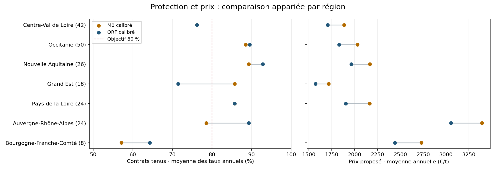
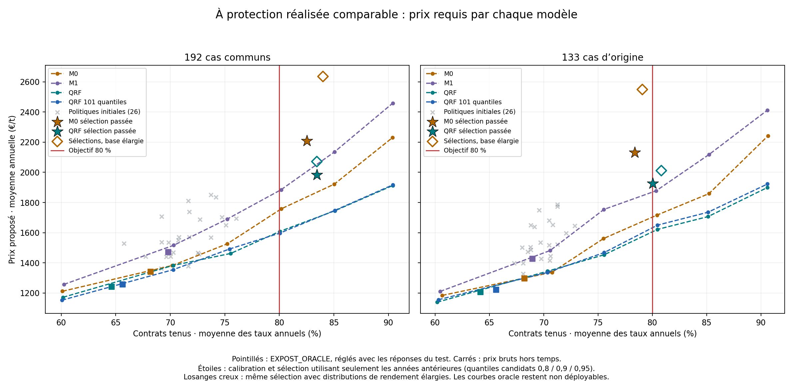

# Audit complet : battre M0 sur le prix à protection comparable

## Résultat et décision

**Il existe maintenant un candidat qui répond mieux à l'objectif que M0 dans le backtest commun : QRF avec correction du prix et sélection uniquement sur le passé.** Les deux familles disposent exactement des mêmes corrections. QRF tient 158 contrats sur 192, contre 156 pour M0, avec un prix moyen inférieur de 10,1 %. Le gain n'est donc plus seulement une baisse de prix accompagnée d'une perte de protection.

| Mesure, mêmes 192 cas 2019–2025 | M0 + sélection passée | QRF + sélection passée |
|---|---:|---:|
| Contrats tenus | 156/192 — 81,25 % | **158/192 — 82,29 %** |
| Moyenne des sept taux annuels | 82,52 % | **83,45 %** |
| Prix moyen, chaque année au même poids | 2 207,53 €/t | **1 984,07 €/t** |
| Prix médian des cas | 1 821,80 €/t | **1 772,95 €/t** |
| Perte du quantile 80 % | 288,03 €/t | **233,04 €/t** |
| Manque moyen de marge, années égales | 40,15 €/ha | **35,27 €/ha** |

Cela représente **−10,1 % sur le prix moyen**, **−19,1 % sur la perte**, **−12,1 % sur le manque moyen**, et deux contrats tenus supplémentaires. Les prix sont des propositions historiques départ ferme, pas de nouvelles prévisions 2026. Le prix moyen n'est pas pondéré par les volumes achetés : ces volumes ne sont pas disponibles dans ce test.

`qrf__past_selected` du run [contract_policies_sensitivity](../experiments/contract_policies_sensitivity/README.md), sur distributions brutes, démontre le gain de la famille QRF à procédure égale. Pour privilégier strictement le prix parmi les sélecteurs temporels atteignant 80 % globalement, `hybrid__global_selected` est moins cher : **1 939 €/t et 155/192 contrats tenus, soit 80,73 %**. Il peut choisir M0 ou QRF selon leurs validations antérieures. QRF seul coûte 45 €/t de plus en moyenne pour trois contrats tenus supplémentaires et un manque moyen plus faible. Ce compromis doit rester visible dans la décision produit. Le transfert francilien reste un problème distinct.

## 1. L'objectif utilisé pour construire le modèle et les tests

Le prix doit être fixé avant campagne, par département, pour que la **marge à l'hectare** de la lentille égale ou dépasse celle du blé dans 80 % des années possibles. Le prix minimal théorique est le quantile 80 % du prix d'équilibre, pas celui du rendement ni du prix de vente seul.

La nouvelle procédure comprend quatre étapes :

1. M0 ou QRF produit un prix de base à partir des 20 000 scénarios historiques, avec météo et prix du blé de la même année.
2. Les erreurs de ce prix sont mesurées sur des prévisions temporelles antérieures, jamais sur les exemples ayant servi à ajuster cette prévision.
3. Plusieurs corrections sont testées : multiplicative, additive, historique cumulé, cinq ou trois ans, globale ou régionale ramenée vers la correction globale. M0 et QRF disposent des mêmes recettes.
4. Chaque année, le sélecteur choisit **le prix moyen le plus bas parmi les politiques ayant tenu au moins 80 % des contrats dans les trois validations précédentes**, à poids égal par année. Si aucune ne satisfait le seuil passé, il choisit la meilleure protection et trace cette absence de solution admissible.

Les quantiles internes de correction 80/90/95 % n'altèrent pas la cible du produit : elle reste **80 %**. Les niveaux supplémentaires testent une réserve contre la dérive des erreurs d'une année à l'autre. Le minimum annoncé par le sélecteur est celui de sa grille de politiques, pas un optimum prouvé sur tous les modèles possibles.

La perte pinball à 0,8 reste cohérente pour comparer la prévision du quantile. Mais une meilleure perte ne suffit pas à annoncer un meilleur contrat : le taux tenu, le prix et le manque à l'hectare sont présentés ensemble. Le [protocole complet](PROTOCOLE_VALIDATION_OBJECTIF80.md) décrit les découpages, groupes et références scientifiques.

## 2. Pourquoi les anciens 86 % sont devenus environ 68 %

**Ce n'est pas principalement une histoire de 133 contre 192 cas.** Les 133 anciens cas sont tous présents dans les 192 nouveaux. J'ai rejoué le pipeline historique puis changé les règles par étapes sur ces mêmes 133 cas, avec M1 inchangé comme famille de modèle.

| Étape de la chaîne M1, mêmes 133 cas | Contrats tenus | Prix médian €/t |
|---|---:|---:|
| Ancien pipeline reproduit exactement | 85,7 % | 2 658 |
| Tirages Monte-Carlo alignés à 20 000 | 85,7 % | 2 603 |
| Regroupement Agreste reconstruit sur le passé utilisable | 79,7 % | 2 005 |
| Préparation météo et normalisation modernes | 78,9 % | 1 923 |
| Calibration temporelle glissante, distributions élargies | 75,9 % | 1 889 |
| Simulations à quantiles bruts | 70,7 % | 1 412 |

Les changements de protocole expliquent donc environ **15 points** de baisse sur les cas communs. Passer ensuite de ces 133 cas aux 192 ramène M1 de 70,7 à 67,7 %, soit environ trois points supplémentaires. Les effets de cette chaîne dépendent de l'ordre des modifications ; le rapport d'attribution conserve cet ordre explicitement.

Le mécanisme économique est clair : le rendement lentille est au **dénominateur** du prix d'équilibre. Élargir sa queue basse augmente les prix nécessaires pour les mauvaises récoltes. Dans le factoriel M1 sur les 133 cas, à modèles et tirages fixes et à poids égal par cas, l'élargissement lentille explique environ 462 €/t de prix moyen supplémentaire, contre environ 6 €/t pour l'élargissement blé. Retirer cet élargissement abaisse les prix et une partie de la protection.

Cela ne signifie pas que l'ancienne distribution simulée était la bonne. La couverture d'un intervalle de rendement ne définit pas automatiquement les vrais quantiles de la distribution complète. La conclusion pratique est de **calibrer et tester le prix du contrat lui-même**, au lieu d'utiliser la couverture de l'intervalle comme preuve de protection économique.

Les 266 prix historiques M0/M1 arrondis et leurs verdicts ont été reproduits exactement. Les 576 prix modernes de référence ont été reproduits à moins de 10⁻⁷ €/t. [Détail de l'attribution et factoriel lentille/blé](../experiments/protocol_attribution/README.md).

## 3. QRF bat-il réellement la baseline M0 ?

Oui dans plusieurs comparaisons contrôlées, mais pas dans toutes les dimensions de chaque variante.

| Protocole commun, 192 cas | Modèle | Perte €/t ↓ | Tenus | Prix médian €/t | Manque €/ha ↓ |
|---|---|---:|---:|---:|---:|
| Quantiles bruts, sans correction du prix | M0 | 243,79 | 66,1 % | 1 254 | 116,84 |
| Idem | QRF, 101 quantiles | 208,48 | 64,1 % | 1 170 | 105,95 |
| Quantiles élargis, sans correction du prix | M0 | 294,63 | 74,0 % | 1 831 | 67,92 |
| Idem | QRF | 198,62 | 75,5 % | 1 483 | 54,69 |
| Quantiles bruts + sélection passée de correction | M0 | 288,03 | 81,3 % | 1 822 | 40,15 |
| Idem | QRF | **233,04** | **82,3 %** | **1 773** | **35,27** |

La version brute très bon marché améliorait la perte tout en abandonnant de la protection. À protocole élargi commun, QRF améliore les quatre indicateurs face à M0, mais reste sous 80 %. La correction directe du prix permet ensuite de dépasser 80 % au total avec un avantage de prix pour QRF.

La comparaison sur les **133 cas d'origine** confirme que les 59 ajoutés ne créent pas ce résultat : les sélecteurs modernes tiennent **81,2 % pour QRF contre 79,7 % pour M0**, avec des prix moyens de **1 925 contre 2 132 €/t**. L'ancien M0 complet tenait 82,0 % sur ces cas, et l'ancien M1 85,7 % ; ce sont des systèmes historiques différents, pas les mêmes corrections appliquées aux deux familles.

Deux recettes fixes complètent le diagnostic : la correction Q90 sur cinq ans atteint **80,2 % à 1 899 €/t** avec QRF ; la correction Q95 sur tout l'historique atteint **84,4 % à 2 054 €/t**. Chacune calcule ses prix seulement sur le passé, mais choisir aujourd'hui la meilleure recette parmi leurs résultats constitue une sélection rétrospective. Le résultat du sélecteur temporel est donc conservé séparément.

## 4. Dans quels groupes le candidat est-il intéressant ?

Le tableau utilise les **politiques calibrées sélectionnées sur le passé**. Chaque région est publiée. Les taux et prix donnent le même poids à chaque année présente dans le groupe : ils peuvent donc différer des fractions calculées en regroupant tous les cas.

| Région | Cas / années | Tenus M0 → QRF | Prix moyen M0 → QRF €/t | Lecture |
|---|---:|---:|---:|---|
| Pays de la Loire | 24 / 7 | 85,7 → 85,7 % | 2 165 → 1 903 | Même protection au-dessus de 80 %, prix −12,1 % |
| Nouvelle-Aquitaine | 26 / 7 | 89,3 → 92,9 % | 2 169 → 1 965 | Protection supérieure, prix −9,4 % |
| Occitanie | 50 / 7 | 88,5 → 89,5 % | 2 033 → 1 832 | Protection supérieure, prix −9,9 % |
| Auvergne-Rhône-Alpes | 24 / 7 | 78,6 → 89,3 % | 3 394 → 3 055 | QRF dépasse 80 %, prix −10,0 % |
| Centre-Val de Loire | 42 / 7 | 76,2 → 76,2 % | 1 885 → 1 707 | Moins cher, mais protection insuffisante |
| Grand Est | 18 / 7 | 85,7 → 71,4 % | 1 716 → 1 573 | La baisse de prix retire trop de protection |
| Bourgogne-Franche-Comté | 8 / 7 | 57,1 → 64,3 % | 2 732 → 2 443 | Progrès incomplet, seulement huit cas |

Ces résultats soutiennent une proposition ciblée sur certains territoires plutôt qu'un remplacement uniforme de M0. Ils ne signifient pas qu'une règle « QRF ici, M0 ailleurs » sélectionnée après lecture du tableau est déjà validée. Le sélecteur régional réellement testé, qui décide uniquement sur le passé, atteint **72,9 %** globalement : il fait moins bien que le choix global de la correction QRF. La segmentation explicative est utile ; la segmentation automatique demande encore une meilleure estimation locale du risque.

Les autres groupes fixés avant inspection des nouveaux scores sont tous disponibles : durée de l'historique, volatilité passée, niveau de rendement passé et donneurs du transfert francilien. Les seuils de volatilité et rendement sont recalculés uniquement avec le passé de chaque année. [Tableaux, intervalles et figures de l'analyse calibrée](../experiments/model_groups_calibrated/README.md).



## 5. Le contrôle départemental change la conclusion

Le prix est départemental : un taux national de 82,3 % ne suffit pas à dire que chaque département est protégé huit années sur dix.

- Parmi les 18 départements avec les sept années complètes, **10 atteignent au moins six réussites sur sept avec QRF**, contre neuf avec M0.
- Parmi les 25 avec au moins cinq années, QRF atteint 80 % observés dans **17**, contre 16 pour M0.
- Aude : **4/7 → 6/7**, prix moyen 1 783 → 1 615 €/t.
- Haute-Loire : **5/7 → 6/7**, prix moyen 3 071 → 2 780 €/t.
- Vendée : **6/7 conservés**, prix moyen 2 088 → 1 798 €/t.
- Aube : **6/7 → 5/7** ; la réduction de prix dégrade la protection.

Sur les séries complètes, les départements 10, 15, 28, 37, 41, 45 et 79 restent à 5/7 avec QRF, et le 89 à 4/7. Les CSV publient aussi les départements à historique plus court, avec leur dénominateur. Ils ne sont pas assimilés à sept années indépendantes.

## 6. Quelles situations provoquent les échecs ?

Les récoltes inférieures à **60 % du niveau historique local** représentent 52 des 192 cas. Dans le QRF dense brut, elles concentrent **49 des 69 échecs**, soit 71 %. Le modèle ne tenait que **3/52** contrats dans ces situations, contre 6/52 pour M0. Hors effondrement, il tenait 120/140 contrats, soit 85,7 %.

Avec la correction du prix et la sélection passée, QRF tient **25/52** contrats lors des effondrements, contre **19/52 pour M0**. Hors effondrement, il tient **133/140**, contre 137/140 pour M0. Le nouveau candidat récupère donc effectivement des contrats dans la queue difficile ; il ne se contente pas d'améliorer les bonnes récoltes.

Le groupe « récolte effondrée » est connu après récolte. Il sert à expliquer le mécanisme, pas à exclure rétrospectivement les cas difficiles ni à supposer leur survenue connue au moment de signer. Les diagnostics pluie/chaleur extrêmes et hausse du prix du blé sont également séparés des variables disponibles avant campagne.

| Année | Cas | M0 calibré tenu | QRF calibré tenu |
|---|---:|---:|---:|
| 2019 | 28 | 71,4 % | 78,6 % |
| 2020 | 30 | 66,7 % | 53,3 % |
| 2021 | 30 | 53,3 % | 63,3 % |
| 2022 | 29 | 86,2 % | 93,1 % |
| 2023 | 27 | 100 % | 100 % |
| 2024 | 24 | 100 % | 100 % |
| 2025 | 24 | 100 % | 95,8 % |

QRF gagne au total, mais **perd quatre contrats face à M0 en 2020** et en gagne trois en 2021. La forte fréquence des chocs en 2020–2022 et le changement de prix du blé expliquent pourquoi une calibration sur les seules bonnes années récentes peut être insuffisante.

## 7. Le gain tient-il à une simple baisse de protection ?

Un diagnostic supplémentaire ajuste après coup un multiplicateur de prix pour donner environ 80 % de protection à chaque modèle, avec des années équipondérées. Sur les 192 cas, le prix moyen requis est **1 758 €/t pour M0**, **1 609 pour QRF** et **1 597 pour QRF dense**. Sur les 133 cas, il est de 1 717 pour M0 et 1 622 pour QRF.

Cela montre un potentiel de baisse de prix à protection comparable. Ce diagnostic utilise cependant les réponses du test : il porte partout le label **EXPOST_ORACLE**, et ses prix ne sont pas des prévisions utilisables avant campagne. Les étoiles de la figure montrent séparément les véritables décisions prises sur le passé, sans réajustement après test.



## 8. Cas de l'Île-de-France : tester réellement le transfert

Les performances précédentes concernent des départements dont le rendement lentille historique est disponible. Pour approcher le problème francilien, j'ai aussi exclu **une région entière**, à chaque année, puis transféré le niveau lentille depuis quatre analogues climatiques hors région. Cela représente 49 séparations région–année et 98 entraînements lentille dans Colab.

| Modèle avec région cible masquée, quantiles bruts | M0 | QRF |
|---|---:|---:|
| Perte contrat | 291,77 | 285,28 |
| Contrats tenus | 58,3 % | 49,0 % |
| Manque moyen €/ha | 144,45 | 158,16 |

Le faible gain de perte QRF ne compense pas ici la dégradation de la protection. Le transfert du **niveau absolu** est un problème majeur : le proxy vaut en médiane 1,63 fois le niveau historique local en Bourgogne et 1,76 fois en Auvergne-Rhône-Alpes. Une hypothèse de rendement trop élevée réduit mécaniquement le prix demandé.

Ce test utilise quatre analogues climatiques ; il ne reproduit pas exactement les quatre voisins fixes de la démo. Il ne prétend pas mesurer directement des récoltes lentille franciliennes absentes des données. Les donneurs actuels 10/28/45/89 sont eux-mêmes fragiles dans le backtest calibré : taux annuel moyen **67,9 % pour QRF contre 71,4 % pour M0**. Le résultat national ne suffit donc pas à remplacer le prix francilien de l'application.

Le prochain travail spécifique au produit francilien est d'améliorer l'estimation du niveau local et de calibrer les erreurs **de transfert**, avec des régions masquées, avant de choisir le modèle de fluctuations. [Rapport de transfert et diagnostics des donneurs](../experiments/spatial_transfer/README.md).

## 9. Ce qui a été testé, conservé et vérifié

- Attribution historique et factoriel brut/élargi : M0, M1, QRF, années 2016–2025 avec échauffement 2016–2018.
- 26 politiques dans le premier essai Q80 ; 50 dans la sensibilité Q80/Q90/Q95 sur distributions brutes ; 50 sur distributions élargies. Ces ensembles se recouvrent : il ne s'agit pas de 126 modèles indépendants.
- Toutes les régions, groupes de risque prédéfinis, diagnostics de crise, départements et années ; comparaisons strictement appariées et bootstrap par années entières.
- Sensibilité aux groupes Agreste : en donnant un poids égal aux groupes finaux, le candidat calibré garde une perte inférieure, **248,73 contre 299,73**, et une meilleure protection annuelle, **81,04 contre 78,62 %**. Cette déduplication rétrospective sert seulement à l'évaluation.
- 49 tests de transfert région–année, avec donneurs hors région et sans utilisation du rendement lentille cible comme caractéristique ou niveau.
- **63 tests Python passent**. Les audits vérifient les coupures temporelles, les cohortes, les sélections, les seuils minimaux avec égalités et l'invariance des décisions quand les observations futures changent. Les résultats Colab ont été téléchargés, comparés aux sources exécutées et recalculés.

Les nouvelles configurations ont été explorées dans le cadre de ce même historique 2019–2025. Le découpage temporel empêche de consulter l'issue d'une année pour décider son prix ; il ne transforme pas cet historique déjà étudié en nouvel échantillon indépendant. Les gains par groupes sont publiés avec les groupes défavorables et les tailles d'échantillon.

## 10. Utilisation pour le projet

**Construction retenue pour la suite : QRF + calibration du prix, avec M0 soumis exactement à la même procédure comme témoin et alternative permanente.** Pour la règle « prix minimal parmi les candidats admissibles », le sélecteur global M0/QRF est le candidat le plus directement aligné avec l'objectif : 80,7 % à 1 939 €/t sur ce replay. Le sélecteur QRF seul fournit un point de comparaison à protection supérieure : 82,3 % à 1 984 €/t. Les quantiles denses apportent peu ; l'amélioration utile vient surtout de la calibration de la décision économique et du contrôle de son coût.

Pour le pitch, le résultat défendable est : « Sur le même backtest, notre candidat tient 82,3 % des contrats contre 81,3 % pour la baseline, avec un prix moyen inférieur de 10 %. Nous identifions les territoires où ce gain se réalise et nous testons séparément le transfert aux départements sans historique lentille. » Il faut conserver la distinction entre ce taux historique et les 80 % visés dans les scénarios.

Pour le produit, afficher par département le prix, le niveau de protection observé, le nombre d'années disponibles et le recours éventuel à un transfert. Le Grand Est, le Centre et les donneurs franciliens demandent une règle locale mieux calibrée. Une règle régionale choisie après lecture du tableau ne doit pas être confondue avec le sélecteur régional testé, qui a ici échoué à atteindre la cible.

## Reproduction et accès aux détails

Les gros CSV de politiques et leurs audits JSON sont conservés à l'identique dans les archives Colab pour limiter le poids des fichiers en double. Les tableaux agrégés, comparaisons et figures restent directement lisibles. Après un clone :

```bash
pip install -r requirements-research.txt
python scripts/restore_audit_artifacts.py
python -m pytest -q
python pipeline/analyze_model_groups.py
python pipeline/analyze_price_frontier.py
```

Les commandes de recalcul des entraînements figurent dans chaque rapport d'expérience. Les fichiers de production de l'application restent ceux de la démo initiale.

- [Protocole et sources scientifiques](PROTOCOLE_VALIDATION_OBJECTIF80.md)
- [Attribution ancien/nouveau](../experiments/protocol_attribution/README.md)
- [Sous-groupes avant correction](../experiments/model_groups/README.md)
- [Politiques Q80 initiales](../experiments/contract_policies/README.md)
- [Sensibilité Q80/Q90/Q95, résultat principal](../experiments/contract_policies_sensitivity/README.md)
- [Même expérience sur distributions élargies](../experiments/contract_policies_expanded/README.md)
- [Sous-groupes et départements après correction](../experiments/model_groups_calibrated/README.md)
- [Frontière prix/protection](../experiments/price_frontier/README.md)
- [Transfert spatial](../experiments/spatial_transfer/README.md)
