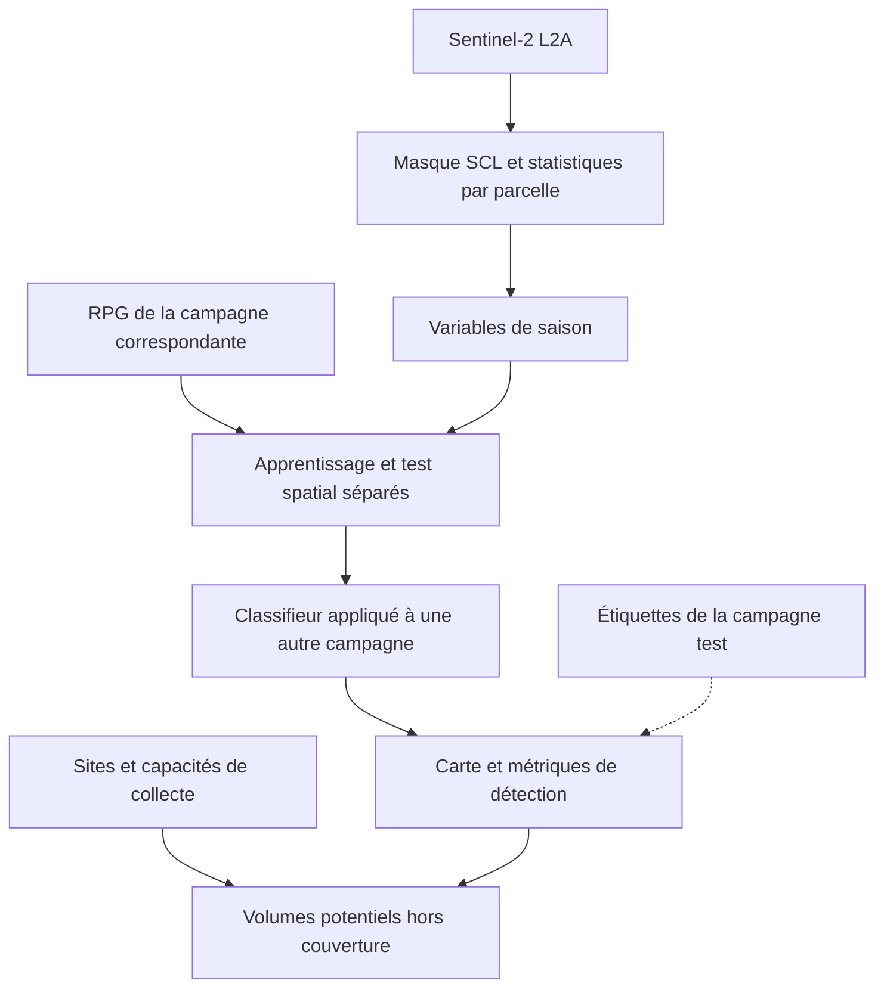

# Feuille de route

**Revue mentor documentée du 31 octobre 2026 : choisir des hypothèses, les simuler et montrer les arbitrages.** Les réponses détaillées et leurs sources sont dans [QUESTIONS.md](QUESTIONS.md). Le cœur doit être démontrable de bout en bout ; chaque extension sert ensuite le même responsable filière et la même carte.

| Temps | Décision de l'utilisateur | Livrable |
|---|---|---|
| 1. Avant les semis | Quel contrat et quelles parcelles ? | Prix, protection, volume et comparaison de barèmes. |
| 2. Où collecter | Quel emplacement parmi les candidats ? | Site déplaçable et coût rendu recalculé. |
| 3. Pendant la saison | Quelles parcelles surveiller ? | Quelques courbes Sentinel en replay, puis détection régionale. |

## État et décisions proposées au samedi 31/10

**Déjà réalisé :** pipeline Agreste / RPG / NASA POWER / Eurostat, modèles comparés, backtest, incertitude sur P*, application en six écrans animés et six annexes, version hors ligne et tests. Le scénario du 31/10 est calculé : version 4 de [RESULTATS.md](RESULTATS.md), P* de 1 567 €/t en Seine-et-Marne, 78 % de contrats tenus en backtest strict, comparaison des contrats comprise.

**Recherche mentor réalisée :** éligibilité de la lentille alimentaire confirmée, montant PAC remis dans sa campagne, références de charges et d'effet précédent trouvées, exemples de contrats réels, coefficients d'impact et choix d'usage RPG / SAA documentés dans [QUESTIONS.md](QUESTIONS.md).

**Revue filière des autres cultures réalisée :** guides Terres Inovia consultés et hypothèses tranchées dans [REVUE_FILIERE_CULTURES.md](REVUE_FILIERE_CULTURES.md) : charges pois chiche 500 €/ha, haricot sec irrigué 1 000, pois 450 et féverole 400. Les prix sont qualifiés par leur nature : paiement rapporté du pois chiche, scénario haricot et référentiel de plan d'entreprise pour pois/féverole. Les sensibilités figurent dans [data/cultures.yaml](../data/cultures.yaml) ; les exports ont été recalculés avec `09_cultures.py` et la lentille retrouve exactement ses résultats précédents.

**Pack de simulation disponible :** [contrat public reconstitué et contrat synthétique](CONTRAT_SIMULATION.md), [partenaires ciblés et proposition 300 t](PILOTE_300T.md), [140 lots fictifs, sources publiques et comparateur reproductible](../data/pilote_300t/README.md). Il permet de tester les paiements et coûts des contrats. Ses barèmes sont branchés sur le moteur : protection face au blé et coût moyen dans l'application (étapes « Le prix » et « Le contrat »).

**Proposition centrale, implémentée le 31/10 :** charges blé 700 €/ha, lentille 500 €/ha ; aide 105 €/ha indicative pour 2026 ; bénéfice de rotation 150 €/ha ; prix payé sur les tonnes acceptées au tri (10 % refusés) ; pilote **300 t nettes alimentaires** et ambition de bassin 5 000 t. Le jeu synthétique reste hors apprentissage et hors backtest.

## La suite, par priorité

### 1. Mettre les choix documentés dans le moteur

- [x] Répondre aux questions agro par des sources : lentille éligible, 105 €/ha indicatifs pour 2026 et 122 €/ha définitifs pour 2025 ; charges et rotation argumentées.
- [x] Revoir les hypothèses des quatre autres légumineuses : références de charges, prix et budget d'irrigation du haricot documentés ; scénarios centraux et sensibilités décidés. Voir [REVUE_FILIERE_CULTURES.md](REVUE_FILIERE_CULTURES.md).
- [x] Recalculer les exports et synchroniser résultats, pitch et interface après cette revue : P\* haricot 2 185 €/t, pois 427 €/t en Seine-et-Marne ; sortie lentille inchangée.
- [x] Fournir un barème public NatUp 2023–2024 reconstitué, un contrat synthétique complet et des paramètres JSON. Voir [CONTRAT_SIMULATION.md](CONTRAT_SIMULATION.md).
- [x] Fournir un historique fictif 2019–2025 et son générateur : masse brute/nette, qualité, refus, paiements et coûts par acteur. Références réelles séparées dans [data/pilote_300t](../data/pilote_300t/README.md).
- [x] Brancher ces barèmes sur les scénarios du moteur et sur le backtest ; les lots fictifs restent hors apprentissage et backtest Agreste.
- [x] Reporter le scénario central et ses sensibilités dans data/hypotheses.yaml ; conserver les paramètres historiques pour reproduire la version 3.
- [x] Recalculer P*, les courbes, le backtest et les exports associés, sans changer le protocole d'évaluation. Version 4 dans [RESULTATS.md](RESULTATS.md) ; README, deck et lettre synchronisés.
- [x] Présenter séparément la marge de campagne et celle intégrant le bénéfice de la culture suivante. Le bonus de rotation est compté une fois : 1 607 €/ha sur la campagne seule (annexe « Deux mauvaises années, rejouées »).
- [x] Remplacer « prix de marché » par « référence historique 2012–2016 » pour la série Eurostat. Ajouter les cas Unéal et NatUp datés documentés dans [QUESTIONS.md](QUESTIONS.md).
- [x] Payer les tonnes alimentaires acceptées. Assiette Agreste vérifiée : rendement « au stade arrivée ferme », avant le tri (méthodologie SAA, p. 3) ; 10 % refusés, sensibilité 0 / 10 / 20 %. Tri et collecte facturés sur les tonnes reçues dans le budget de l'acheteur (annexe du contrat).
- [x] Faire l'audit court RPG / SAA : même campagne, 178 identifiants uniques, filtre 1 ha sans effet notable ; 70 % de l'écart en Seine-et-Marne, compatible avec le rattachement au siège. Détail dans [QUESTIONS.md](QUESTIONS.md) §5.

**Critère de sortie :** toutes les vues d'un scénario utilisent le même jeu d'hypothèses et les mêmes exports. Le nouveau prix est un résultat calculé. Le dossier de prospection permet de demander un contrat complet et des données de lots à un partenaire réel.

### 2. Montrer une décision de contrat et un impact chiffré

- [x] Ajouter deux volumes : **pilote 300 t nettes alimentaires** et **ambition 5 000 t** avec son assiette explicite. Montrer les surfaces nécessaires et les tonnes potentielles ; un scénario de mobilisation à 10 % peut compléter la sélection économique.
- [x] Afficher le prix uniforme selon la protection visée, puis l'option indexée : m × prix du blé de récolte, 3,44 en médiane, 7,44 pour 8 années sur 10 (annexe du contrat, « Quatre façons de garantir 8 années sur 10 »).
- [x] Faire varier le prix du blé pour montrer le budget de l'acheteur : de 357 à 625 k€ d'achat indexé pour 300 t (annexe du contrat). L'indexation transfère ce risque ; le risque de rendement reste porté par l'agriculteur, d'où l'offre d'assurance.
- [x] Comparer sur le jeu synthétique les trois barèmes : référence publique **900 / 700 / 600**, proposition **1 000 / 750 / 650** et prix uniforme **900 €/t**. Les règles communes de qualité et de service sont des conventions de simulation ; voir [contrats.json](../data/pilote_300t/contrats.json).
- [x] Intégrer le barème synthétique 1 000 / 750 / 650 €/t aux scénarios du modèle ; comparer aussi **900 €/t + une prime par hectare calculée** (491 €/ha).
- [x] Comparer les contrats avec les mêmes scénarios du modèle : fréquence de marges gagnantes, coût moyen pour l'acheteur et perte des mauvaises années ; backtest année par année dans `data/backtest.json`, et 2020, 2021, 2022 contrat par contrat dans l'annexe du contrat. Les résultats du jeu fictif illustrent les mécanismes sans valider leur fréquence réelle.
- [x] Ajouter les protéines potentielles : **25 %** de la masse de graines alimentaires ; référence Terres Inovia / Terres Univia disponible.
- [x] Ajouter l'azote minéral non apporté : **180 kg N par nouvel hectare de blé remplacé**, scénario régional arrondi.
- [x] Ajouter les émissions directes associées à cet azote : **environ 0,755 t CO₂e/ha**, avec le périmètre expliqué. Les formules et sources GIEC sont dans [QUESTIONS.md](QUESTIONS.md).

**Critère de sortie :** l'utilisateur peut arbitrer entre coût, protection et volume, et voir l'impact du scénario choisi. Le récit commercial est « comparer et calibrer les contrats existants » ; les 29 % de la baseline ne sont pas attribués à toute la profession.

### 3. Livrer la démo et répéter

- [x] Corriger le prompt de la lettre : « 8 années sur 10 » signifie que la marge lentille atteint celle du blé dans le modèle ; ce chiffre ne mesure pas la fiabilité de la coopérative.
- [x] Dans le compte AWS de l'équipe, vérifier une invocation Bedrock puis générer la lettre et la mettre en cache ; procédure dans [AWS.md](AWS.md). Lettre régénérée avec les chiffres de la version 4 (barème par tranches).
- [ ] Version web déployée par Amplify à chaque push sur `main`, version hors ligne exportée. Vidéo de secours de 4 minutes rendue image par image (branche `video-demo`). Reste : vérifier le parcours complet sur l'ordinateur de démo.
- [x] Confirmer la règle sur les assistants de code externes ; Claude Code et ChatGPT déclarés dans [DECLARATIONS.md](DECLARATIONS.md).
- [ ] Track 3 déclaré. Reste : choisir présentateur et opérateur de démo ; répéter en français.
- [x] Préparer la proposition commerciale, les contacts publics et le brouillon de prise de contact pour un pilote de 300 t nettes : [PILOTE_300T.md](PILOTE_300T.md).
- [ ] Obtenir l'accord d'un candidat et un extrait de données pour comparer son contrat. Le dossier préparé ne constitue pas un engagement du partenaire.

### 4. Étendre la démonstration pendant l'événement

Dès que le parcours cœur fonctionne avec des chiffres cohérents, prendre ces extensions dans cet ordre. Les temps ci-dessous sont des budgets de travail proposés.

| Priorité | Extension | Budget de travail | Critère de sortie |
|---|---|---|---|
| 1 | ~~Site de collecte déplaçable~~ **fait** | 1 h | Distances, coût rendu, tonnes et courbe se recalculent ; meilleur point d'une grille. |
| 2 | ~~Suivi Sentinel de 5 à 10 parcelles~~ **fait** (8 parcelles, annexe « La saison, vue par satellite ») | 1 à 2 h | Courbes précalculées, dates et pixels valides affichés, replay clairement nommé. |
| 3 | ~~Le Maillon vu du ciel, zone réduite~~ **fait** (annexe « Vu du ciel ») | Créneau restant avant le gel | Carte de classes et métriques sur des carrés de 4 km tenus à l'écart ; transfert 2024 → 2025 testé. |
| 4 | Météo pondérée par les surfaces ; variables par stade | Non retenu pour le dépôt : les chiffres validés en backtest strict restent la référence | Limite annoncée dans [LIMITES.md](LIMITES.md). |
| 5 | ~~Autres cultures~~ **fait** (pois chiche, haricot, pois, féverole) ; ~~offre assureurs~~ **faite** (prime pure, écran 6) ; ~~carte de France des prix~~ **faite** ; ~~sites de collecte existants~~ **faits** (Sirene) ; données coopératives demandées aux partenaires | Selon capacité disponible | Une preuve ciblée ou une maquette clairement identifiée. |

Les scénarios de stress restent séparés du backtest. Toute amélioration inspirée par les années 2020–2021 devient une nouvelle exploration, avec une évaluation distincte des résultats déjà consultés.


## 1. Planning du hackathon

| Quand | Objectif | Critère de sortie |
|---|---|---|
| Ven. 30/10, soir | déclarer le Track 3 ; dépôt et documentation ; panel Agreste ; météo NASA POWER | `panel_rendements.csv` et `meteo_dept.csv` existent |
| Ven. nuit | baseline M0 ; parcelles RPG sur la carte ; front sur données synthétiques au bon format | la carte s'affiche, le curseur fait basculer les parcelles |
| Sam. 31/10, 10h15–13h | scénario mentor, comparaison de contrats et impact | démo cliquable avec hypothèses et chiffres cohérents |
| Sam. 14h–18h | prix et backtest du scénario, site déplaçable, prototype Sentinel selon avancement | arbitrage prix / protection / volume visible ; extensions utilisables |
| Sam. soir | texte du contrat (LLM, cache) ; impact chiffré ; deck ; **gel du code** ; vidéos ; version fichier unique | plus aucune fonctionnalité après le gel |
| Dim. 1/11, 8h30–9h30 | dépôt du deck PDF, de la fiche projet et des déclarations ; test sur l'ordinateur commun | dépôt avant 9h30 (viser 9h) |

### Points de décision

| Moment | Condition | Si oui | Si non |
|---|---|---|---|
| Sam. 10h | le panel lentille et la démo existent déjà | on garde la lentille et le Track 3 | si une panne technique survient, repartir de l'export fonctionnel |
| Sam. 13h | le scénario recalculé est cohérent dans toutes les vues | comparaison de contrats et impact | garder la version 3 identifiée, présenter les nouveaux paramètres comme scénarios à calculer |
| Sam. 18h | les contrats et l'impact sont démontrables | temps 2 puis temps 3 selon avancement | concentrer le créneau sur la démo et la répétition |
| Sam. soir | cœur et extensions intégrées avant le gel | répétition avec les extensions qui tournent | conserver les prototypes séparés et présenter leur prochaine décision utile |

### Coupes possibles

- Météo inaccessible : modèle avec tendance, effet département et rééchantillonnage des résidus. L'apport de l'IA est alors plus faible, et on le dit.
- RPG inutilisable : parcelles synthétiques clairement étiquetées, sur les contours réels des départements.
- Pas de série de prix du blé : fourchette documentée en hypothèse, avec analyse de sensibilité.

---

## 2. Temps 1 · Le Contrat qui Tient (cœur)

Décrit dans [PROJET.md](PROJET.md), [MODELE.md](MODELE.md) et [ARCHITECTURE.md](ARCHITECTURE.md).

**Moments forts de la démo** :

1. **La bascule** : on monte le prix, les parcelles candidates virent au vert, le compteur de tonnes potentielles monte et la courbe d'offre se dessine. Comparer le pilote de 300 t nettes alimentaires à l'ambition de 5 000 t, avec l'assiette des volumes affichée.
2. **Le replay** :
   - 2016 : le blé s'effondre (−27 %, **mesuré**) et la lentille tient (−13 %) ; le contrat aurait sauvé l'année ;
   - 2020 : la lentille s'effondre (−38 %, **mesuré**) ; on voit où le contrat a tenu et où il a cédé.
3. **La preuve sur années tenues à l'écart** : afficher le backtest glissant 2019–2025 et ses résultats année par année. Chaque prédiction utilise uniquement les données des années antérieures, conformément à [MODELE.md](MODELE.md).
4. **Le choix du contrat** : comparer prix uniforme, indexation et nouveau barème, avec leur coût acheteur et leur protection effectivement calculée.

---

## 3. Temps 2 · Où collecter (extension légère, environ 1 h)

**Question** : « Où placer mon site de tri ou de collecte pour sécuriser le plus de tonnes à un prix donné ? »

**Principe** : le coût variable de transport est déjà dans le modèle. Rendre le site acheteur déplaçable et ajouter le forfait de collecte proposé dans [QUESTIONS.md](QUESTIONS.md).

- Le responsable filière fait glisser le site sur la carte ; les distances, les prix rendus, les bascules et la courbe d'offre se recalculent en direct dans le navigateur.
- Bouton « meilleur emplacement parmi les candidats » : recherche sur une grille, précalculée ou exécutée dans un Web Worker. Indiquer que l'optimum dépend du prix, des sites testés et des hypothèses.
- Option : afficher les établissements existants de collecte et de stockage de grains (base Sirene, codes NAF à vérifier) comme points de départ.

**Ce qu'il faut côté données** : les géométries de parcelles déjà exportées dans `app/src/data/parcels.json` permettent de calculer des centres représentatifs ; les centroïdes sont aussi dans `data/parcelles.json`. Le P* départemental reste indépendant du site. Conserver les mêmes conventions de distance et de coût dans toutes les vues.

Pour un contrat uniforme exprimé par tonne nette acceptée, avec un P* recalculé sur cette même assiette :

```
collecte_par_t_recue[i](site) = forfait_collecte + κ · 1,3 · haversine(centroïde_i, site)
cout_collecte[i](site) = collecte_par_t_recue[i](site) · tonnes_recues_i
prix_rendu_net[i](site) = P*_net_dep(i) + cout_collecte[i](site) / tonnes_nettes_i
tonnes_candidates(site, Q) = Σ tonnes_nettes_i · 1{ Q ≥ prix_rendu_net[i](site) }
tonnes_mobilisables(site, Q) = adoption · tonnes_candidates(site, Q)
```

**Hypothèses proposées** : forfait 5 €/t reçue, κ = 0,12 €/t reçue/km, détour 1,3 et adoption paramétrable. Le ratio tonnes reçues / tonnes nettes convertit les assiettes. Un lot sans tonne acceptée conserve ses frais mais son coût par tonne nette est non défini. Le prix rendu couvre ici l'achat et la collecte. Le budget complet ajoute tri, séchage, stockage et conditionnement selon son périmètre. Sur 100 km routiers, le terme variable vaut 12 €/t reçue : la carte améliore la collecte, les contrats et le choix du bassin portent l'essentiel de l'arbitrage économique.

---

## 4. Temps 3 · Pendant la saison (extension)

**Question** : « Mes parcelles sous contrat poussent-elles bien cette année ? Quelle collecte attendre ? »

**Principe léger** : démarrer avec 5 à 10 parcelles dont la culture est connue pour la campagne utilisée. Au hackathon de fin octobre, montrer un **replay 2025** associé au RPG 2025 vérifié ; une vue 2026 utilise une déclaration de culture 2026 ou porte le statut d'hypothèse. Le RPG de l'année précédente ne donne pas la culture actuelle.

Comparer les courbes à des références **de lentille** et de calendrier comparables. Une même parcelle a pu porter du blé l'année précédente : son historique brut ne constitue pas une référence lentille.

- Indice : NDVI = (B08 − B04) / (B08 + B04), Sentinel-2 L2A.
- Masque nuages : garder `SCL = 4` (végétation) et `SCL = 5` (sol nu), exclure notamment l'eau `SCL = 6`. Les classes viennent de la documentation [Copernicus Sentinel-2 L2A](https://documentation.dataspace.copernicus.eu/APIs/SentinelHub/Data/S2L2A.html).
- Statistique zonale : médiane du NDVI par parcelle et par date, sur un tampon intérieur de 10 m pour limiter les bords ; prévoir le cas des petites parcelles dont le tampon devient vide.
- Qualité : afficher le nombre de pixels et les dates réellement observées. Seuil de 70 % de pixels valides, tampon de 10 m et grille de 10 jours sont des choix d'ingénierie.
- Lissage : interpolation courte puis Savitzky-Golay si utile ; laisser visibles les longues périodes sans observation.
- Affichage : courbe de la campagne rejouée contre une enveloppe de références lentille ; signaler une anomalie à examiner si elle s'en écarte.

**Limite à annoncer** : sans rendement mesuré à la parcelle, on ne transforme pas le NDVI en tonnes. C'est un signal d'alerte, pas une prévision de récolte.

---

## 5. Le Maillon vu du ciel

### Le problème

Pour produire plus de légumineuses, il faut aussi la chaîne derrière : tri, nettoyage, stockage, conditionnement. Pour décider où investir dans un site, il faut savoir où poussent les légumineuses. La couche publique du RPG est millésimée et diffusée avec un décalage : elle décrit les parcelles de l'année N dans leur situation arrêtée au 1er janvier N+1. Elle ne fournit pas directement la culture d'une saison en cours. [Source IGN](https://www.data.gouv.fr/datasets/rpg).

### Ce que fait le produit

1. **Détecter** les parcelles de légumineuses de la saison en cours à partir des séries Sentinel-2, avant la récolte.
2. **Apprendre** sur les images et les étiquettes de la même campagne N−1, puis tester la campagne N avec ses propres étiquettes lorsqu'elles sont disponibles. Pour un prototype 2025, séparer aussi spatialement les parcelles d'apprentissage et de test.
3. **Croiser** avec les sites de tri et de stockage existants pour repérer le goulot : les surfaces sans capacité à proximité.

### Architecture cible



| Étape | Choix technique |
|---|---|
| Accès aux images | Earth Search STAC v1 ; collection `sentinel-2-c1-l2a`, bucket `e84-earth-search-sentinel-data`, région `us-west-2`, d'après le [registre AWS](https://registry.opendata.aws/sentinel-2-l2a-cogs/). Choisir une collection couvrant les dates du prototype et conserver ses métadonnées. |
| Lecture | `pystac-client`, `rioxarray` ou `stackstac`, lecture fenêtrée par emprise de parcelle |
| Nuages | SCL 4 et 5 ; suppression des dates à moins de 70 % de pixels valides (seuil supposé). |
| Variables | NDVI et un indice d'humidité (NDMI), série lissée, variables phénologiques |
| Modèle | LightGBM, classes déséquilibrées (pondération) |
| Validation | **par blocs géographiques** (pas de parcelles voisines entre apprentissage et test), puis transfert temporel N-1 → N |
| Métriques | précision, rappel, F1 par classe, surface détectée contre surface RPG |
| Goulot | rayon ou temps de trajet autour des sites, tonnes potentielles hors couverture |

### Ce qu'il faut pour le faire pendant l'événement

Le volume d'images, les nuages et le prétraitement sont les points durs. Pour tenir dans le temps : une zone réduite autour du site acheteur, des images 2025 entre avril et juillet et des étiquettes RPG 2025 vérifiées. Garder un bloc géographique de test intact. Une validation sur la même campagne ne démontre pas encore le transfert à 2026 : réserver ce nom au test temporel correspondant. Toute prédiction dite « avant récolte » n'utilise que les images disponibles avant sa date de coupure.

### Résultat du prototype (31/10)

Fait sur 24 × 24 km autour du site, campagnes 2024 et 2025 ([RESULTATS.md §10](RESULTATS.md#10-le-maillon-vu-du-ciel-prototype-sentinel-2)). Dans la campagne, avec les parcelles d'un carré de 4 km sur cinq comme exemples, le modèle retrouve 73 % des légumineuses des autres carrés en fin de saison, avec 90 % de signalements justes ; 45 % et 69 % au 10 juin. Le transfert N−1 → N échoue : appris sur 2024, il retrouve 8 % des légumineuses de 2025, à cause d'un printemps 2024 très nuageux et d'une maturité des féveroles avancée de plus d'un mois en 2025. Le nom « transfert à 2026 » reste donc réservé : il faudra plusieurs campagnes d'apprentissage et le radar Sentinel-1.

### Modèle économique

- Clients : coopératives et négociants (prévision de collecte, logistique), industriels (choix d'implantation), interprofessions et pouvoirs publics (suivi du plan protéines).
- Offre : abonnement à des données régionales de saison, ou étude ponctuelle avant un investissement.
- Point de vigilance : la télédétection agricole est un marché déjà occupé. La différenciation tient au couplage avec le prix du contrat et la logistique de la filière.

---

## 6. Passage à l'échelle

| Piste | Ce qu'elle apporte |
|---|---|
| Données de rendement de coopératives | passer du département à la parcelle, et corriger la sous-estimation du risque |
| Autres cultures sous contrat | pois chiche, haricot sec, chanvre, sorgho : même moteur, nouveaux libellés Agreste |
| Autres régions | le même calcul donne déjà le prix de 24 départements producteurs (écran 6) ; seule la couche parcellaire change |
| Modèle hiérarchique bayésien | partage d'information entre départements peu renseignés |
| Bruche et qualité alimentaire | intégrer le volume payé après tri ; sensibilité 0 / 10 / 20 % de non-valorisation alimentaire, **supposée**, à rapprocher des données coopératives |
| Offre assureurs | prime pure calculée sur la même distribution (231 €/ha pour 70 % du rendement moyen) ; chargements et conditions de couverture à construire avec un assureur |
| Réseau de collecte | 352 établissements du commerce de grains autour de l'Île-de-France (Sirene) ; capacités et silos réels à obtenir des coopératives |
| Marché | 142 coopératives agricoles et 28 unions font le commerce des grains en France (Sirene) |
| Historique RPG | rotations réelles, éligibilité plus fine (précédent cultural) |

## 7. Décisions de mentor et sources

Les charges, la rotation, les aides, les références de contrats, les volumes et les coefficients d'impact sont expliqués et sourcés dans [QUESTIONS.md](QUESTIONS.md). Les décisions propres au pois chiche, au haricot, au pois et à la féverole figurent dans [REVUE_FILIERE_CULTURES.md](REVUE_FILIERE_CULTURES.md) et sont enregistrées dans [SOURCES.md](SOURCES.md). Les références Sentinel et RPG sont liées dans les sections ci-dessus. Le registre documentaire commun doit rester synchronisé avec le deck et l'interface.
