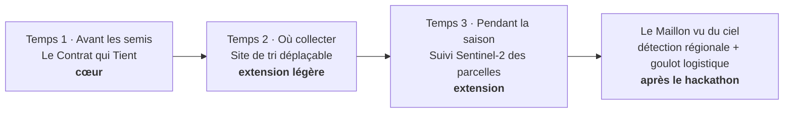
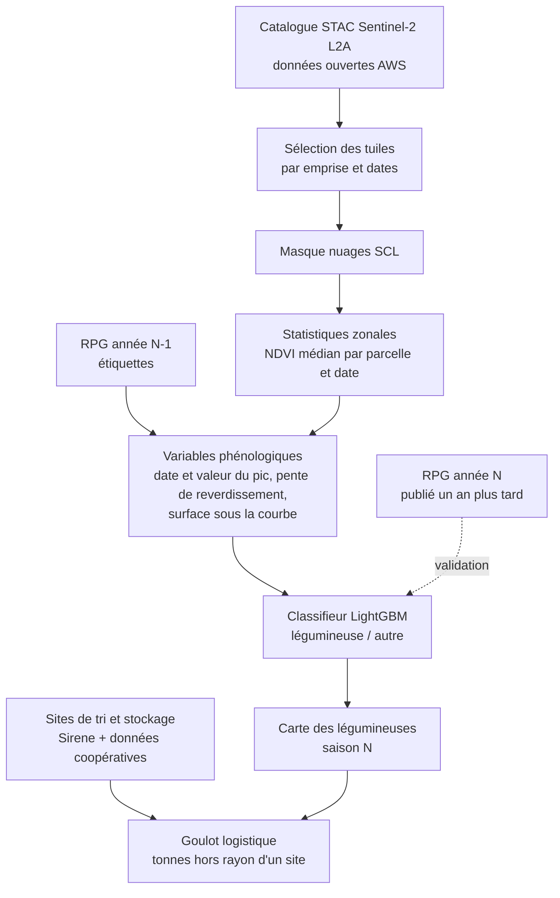

# Feuille de route

Le projet est construit en couches. Le cœur doit être parfait avant toute extension. Chaque extension se branche sur le même utilisateur (le responsable filière) et sur la même carte.



---

## État au vendredi 30/10, soir

Fait : pipeline complet sur données réelles (Agreste, RPG 2025, NASA POWER, Eurostat), deux modèles d'apprentissage comparés, backtest sans fuite, incertitude sur P\*, 15 tests, application en cinq étapes avec version hors ligne, documentation et contenu du deck. Reste : confronter les hypothèses à un mentor, brancher Bedrock, déployer sur Amplify, répéter.

## La suite, par priorité (décidé le 30/10 au soir)

### 1. Fiabiliser l'existant (samedi matin)

- [ ] Faire valider les hypothèses par un mentor agro (`docs/QUESTIONS.md`) : charges, éligibilité de la lentille à l'aide couplée, transport, bonus de rotation. Un bonus de rotation sourcé de 100 à 200 €/ha ferait passer P\* de 1 622 à environ 1 400 €/t en Seine-et-Marne.
- [ ] Corriger le prompt de la lettre Bedrock : préciser que « 8 années sur 10 » désigne les années où la lentille rapporte au moins autant que le blé, pas la fiabilité de la coopérative. Puis relancer `06_lettre_llm.py` dans CloudShell (`docs/AWS.md`).
- [ ] Expliquer l'écart en Île-de-France entre le RPG (1 095 ha de lentille déclarés) et Agreste (environ 730 ha).

### 2. Compléter l'impact (samedi matin)

L'impact pèse 30 % de la note et ne montre aujourd'hui que les tonnes et la part des importations.

- [ ] Protéines produites : teneur de la lentille sèche dans Ciqual (site indisponible le 30/10, à réessayer).
- [ ] Azote minéral évité : dose sur blé contre zéro sur lentille, à sourcer (Agreste, pratiques culturales).
- [ ] Émissions évitées en CO2e : facteur ADEME Base Empreinte ou HESTIA.

### 3. Le contrat indexé sur le prix du blé (samedi)

- [ ] Afficher à l'étape 5 une deuxième option : un plancher égal à m × le prix du blé de la récolte. Le calcul existe déjà (`meta.contrat_indexe` : multiplicateur médian 3,6 ; 7,8 pour 8 années sur 10). Il retire à l'agriculteur le risque lié au prix du blé.

### 4. Améliorer le modèle (samedi après-midi, si le cœur est stable)

- [ ] Météo pondérée par les surfaces cultivées (RPG) plutôt qu'au centroïde du département.
- [ ] Variables météo par stade de la lentille (floraison, récolte).
- [ ] Scénarios de stress pour les années d'effondrement comme 2020 et 2021, sans jamais toucher aux années test.
- [ ] Garder l'historique des versions et de leurs résultats dans `docs/RESULTATS.md`.

### 5. Extensions (après le cœur, ou en perspective dans le pitch)

- [ ] Site de tri déplaçable (temps 2 ci-dessous) : environ 1 h, fort effet visuel.
- [ ] Suivi Sentinel-2 des parcelles sous contrat (temps 3).
- [ ] Le Maillon vu du ciel (section 5).
- [ ] Après le hackathon : données de rendement des coopératives (passage à la parcelle, P\* moins incertain), autres cultures sous contrat (pois chiche, haricot sec), offre pour les assureurs.

## 1. Planning du hackathon

| Quand | Objectif | Critère de sortie |
|---|---|---|
| Ven. 30/10, soir | déclarer le Track 3 ; dépôt et documentation ; panel Agreste ; météo NASA POWER | `panel_rendements.csv` et `meteo_dept.csv` existent |
| Ven. nuit | baseline M0 ; parcelles RPG sur la carte ; front sur données synthétiques au bon format | la carte s'affiche, le curseur fait basculer les parcelles |
| Sam. 31/10, 10h15–13h | **squelette de bout en bout** avec un P\* grossier ; hypothèses testées avec un mentor | démo cliquable du début à la fin |
| Sam. 14h–18h | M1 et conformal ; backtest ; courbe d'offre ; replay 2016 et 2020 | l'écran de preuve affiche de vrais chiffres |
| Sam. soir | texte du contrat (LLM, cache) ; impact chiffré ; deck ; **gel du code** ; vidéos ; version fichier unique | plus aucune fonctionnalité après le gel |
| Dim. 1/11, 8h30–9h30 | dépôt du deck PDF, de la fiche projet et des déclarations ; test sur l'ordinateur commun | dépôt avant 9h30 (viser 9h) |

### Points de décision

| Moment | Condition | Si oui | Si non |
|---|---|---|---|
| Sam. 10h | la lentille est exploitable sur le panel national | on garde la lentille | pois chiche ou haricot sec **pour l'alimentation humaine**, annoncé comme tel |
| Sam. 13h | le squelette tourne de bout en bout | vrai modèle et backtest | on coupe le replay et le texte du LLM, on garde curseur et backtest |
| Sam. 18h | modèle et backtest affichent de vrais chiffres | temps 2 (site de tri déplaçable) | on peaufine le cœur, rien d'autre |
| Sam. soir | cœur et temps 2 propres | temps 3 léger | le temps 3 reste une slide |

### Coupes possibles

- Météo inaccessible : modèle avec tendance, effet département et rééchantillonnage des résidus. L'apport de l'IA est alors plus faible, et on le dit.
- RPG inutilisable : parcelles synthétiques clairement étiquetées, sur les contours réels des départements.
- Pas de série de prix du blé : fourchette documentée en hypothèse, avec analyse de sensibilité.

---

## 2. Temps 1 · Le Contrat qui Tient (cœur)

Décrit dans [PROJET.md](PROJET.md), [MODELE.md](MODELE.md) et [ARCHITECTURE.md](ARCHITECTURE.md).

**Moments forts de la démo** :

1. **La bascule** : on monte le prix, les parcelles de blé virent au vert en partant du site acheteur, le compteur de tonnes monte, la courbe d'offre se dessine.
2. **Le replay** :
   - 2016 : le blé s'effondre (−27 %, **mesuré**) et la lentille tient (−13 %) ; le contrat aurait sauvé l'année ;
   - 2020 : la lentille s'effondre (−38 %, **mesuré**) ; on voit où le contrat a tenu et où il a cédé.
3. **La prédiction à l'aveugle** : données coupées en 2019, la bande d'incertitude s'affiche pour chaque année de 2020 à 2025, puis le point réel tombe.

---

## 3. Temps 2 · Où collecter (extension légère, environ 1 h)

**Question** : « Où placer mon site de tri ou de collecte pour sécuriser le plus de tonnes à un prix donné ? »

**Principe** : le coût de transport est déjà dans le modèle. Il suffit de rendre le site acheteur déplaçable.

- Le responsable filière fait glisser le site sur la carte ; les distances, les prix rendus, les bascules et la courbe d'offre se recalculent en direct dans le navigateur.
- Bouton « meilleur emplacement » : recherche sur une grille de positions candidates, précalculée ou exécutée dans un Web Worker.
- Option : afficher les établissements existants de collecte et de stockage de grains (base Sirene, codes NAF à vérifier) comme points de départ.

**Ce qu'il faut côté données** : rien de plus. `parcels.geojson` contient déjà les centroïdes, et `p_star_dep` est indépendant du site.

```
prix_rendu[i](site) = P*_dep(i) + κ · 1,3 · haversine(centroïde_i, site)
tonnes(site, Q)     = Σ tonnes_attendues_i · 1{ Q ≥ prix_rendu[i](site) }
```

---

## 4. Temps 3 · Pendant la saison (extension)

**Question** : « Mes parcelles sous contrat poussent-elles bien cette année ? Quelle collecte attendre ? »

**Principe léger** : pas de détection de culture. Le RPG dit déjà où sont les parcelles. On affiche la courbe de verdure de quelques parcelles de lentille de la saison, comparée aux saisons précédentes.

- Indice : NDVI = (B08 − B04) / (B08 + B04), Sentinel-2 L2A.
- Masque nuages : couche de classification de scène `SCL` (on garde végétation, sol nu, eau).
- Statistique zonale : médiane du NDVI par parcelle et par date, sur un tampon intérieur de 10 m pour éviter les bords.
- Lissage : interpolation sur une grille de 10 jours, puis Savitzky-Golay.
- Affichage : courbe de la saison en cours contre l'enveloppe des saisons passées ; alerte si la courbe sort de l'enveloppe.

**Limite à annoncer** : sans rendement mesuré à la parcelle, on ne transforme pas le NDVI en tonnes. C'est un signal d'alerte, pas une prévision de récolte.

---

## 5. Le Maillon vu du ciel (après le hackathon)

### Le problème

Pour produire plus de légumineuses, il faut aussi la chaîne derrière : tri, nettoyage, stockage, conditionnement. Pour décider où investir dans un site, il faut savoir où poussent les légumineuses. Or le RPG d'une campagne n'est publié qu'**un an après**.

### Ce que fait le produit

1. **Détecter** les parcelles de légumineuses de la saison en cours à partir des séries Sentinel-2, avant la récolte.
2. **Vérifier** sur le RPG de l'année précédente (entraînement) puis de l'année en cours lorsqu'il sort (validation).
3. **Croiser** avec les sites de tri et de stockage existants pour repérer le goulot : les surfaces sans capacité à proximité.

### Architecture cible



| Étape | Choix technique |
|---|---|
| Accès aux images | Sentinel-2 L2A en GeoTIFF optimisés cloud, via un catalogue STAC sur les données ouvertes AWS [à vérifier : bucket et région] |
| Lecture | `pystac-client`, `rioxarray` ou `stackstac`, lecture fenêtrée par emprise de parcelle |
| Nuages | couche `SCL`, plus suppression des dates à moins de 70 % de pixels valides [seuil supposé] |
| Variables | NDVI et un indice d'humidité (NDMI), série lissée, variables phénologiques |
| Modèle | LightGBM, classes déséquilibrées (pondération) |
| Validation | **par blocs géographiques** (pas de parcelles voisines entre apprentissage et test), puis transfert temporel N-1 → N |
| Métriques | précision, rappel, F1 par classe, surface détectée contre surface RPG |
| Goulot | rayon ou temps de trajet autour des sites, tonnes potentielles hors couverture |

### Pourquoi après le hackathon

Le volume de données, les nuages et le prétraitement demandent plus de 36 heures pour un résultat fiable. Une démonstration partielle risquerait de fragiliser la note de rigueur.

### Modèle économique

- Clients : coopératives et négociants (prévision de collecte, logistique), industriels (choix d'implantation), interprofessions et pouvoirs publics (suivi du plan protéines).
- Offre : abonnement à des données régionales de saison, ou étude ponctuelle avant un investissement.
- Point de vigilance : la télédétection agricole est un marché déjà occupé. La différenciation tient au couplage avec le prix du contrat et la logistique de la filière.

---

## 6. Au-delà

| Piste | Ce qu'elle apporte |
|---|---|
| Données de rendement de coopératives | passer du département à la parcelle, et corriger la sous-estimation du risque |
| Autres cultures sous contrat | pois chiche, haricot sec, chanvre, sorgho : même moteur, nouveaux libellés Agreste |
| Autres régions | entraînement national déjà en place ; seule la couche parcellaire change |
| Modèle hiérarchique bayésien | partage d'information entre départements peu renseignés |
| Bruche | intégrer le risque de perte de qualité (10 à 20 % de pertes, **sourcé**) |
| Offre assureurs | même distribution de rendement pour tarifer l'assurance récolte |
| Historique RPG | rotations réelles, éligibilité plus fine (précédent cultural) |
