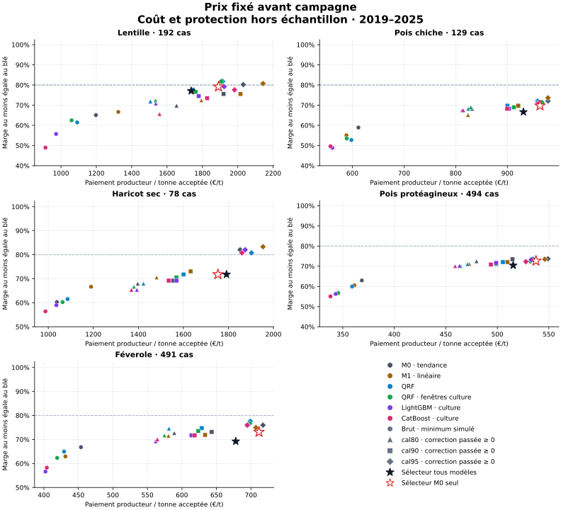
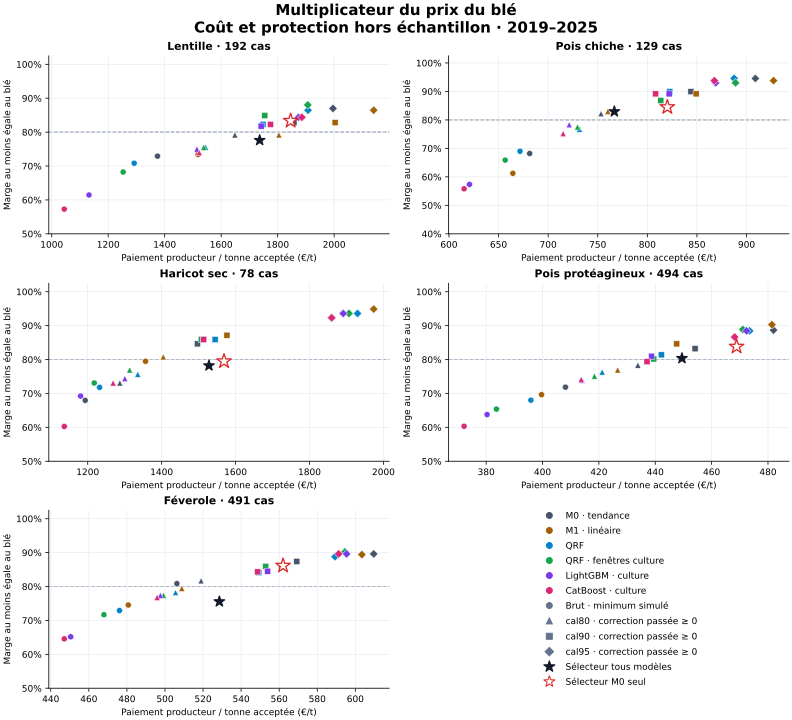
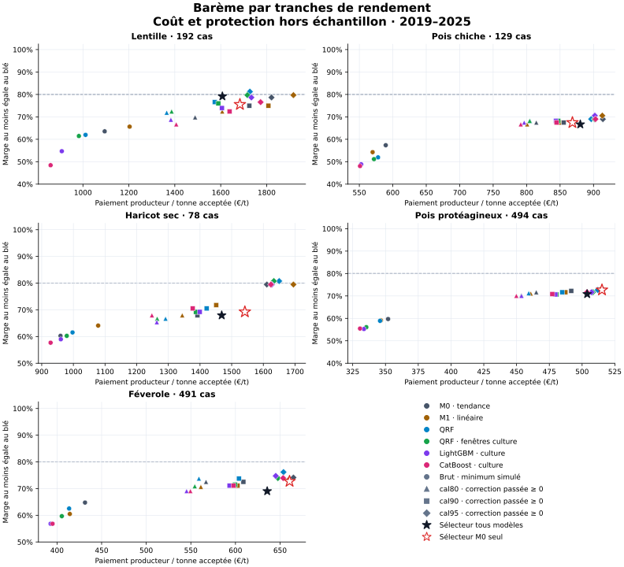

# Audit des cinq légumineuses : prix, contrats et sélection temporelle

Le résultat recherché est un paiement producteur aussi faible que possible, tout en égalant ou dépassant la marge du blé dans au moins 80 % des cas testés. Les égalités comptent comme tenues. La comparaison porte sur les mêmes départements et années pour chaque modèle.

## Protocole et unités

- Années évaluées : 2019–2025. Prédictions hors temps 2016–2018 pour amorcer la calibration et la sélection ; aucune année test n'est utilisée avant sa date.
- M0 est la tendance linéaire des rendements relatifs avec quantiles de résidus. M1 ajoute les six variables météo historiques ; les candidats QRF, LightGBM et CatBoost utilisent la même cohorte, avec une variante de fenêtres agronomiques par culture.
- Prix fixe : €/t acceptée fixé avant campagne. Indexé : multiplicateur fixé avant campagne, appliqué au prix du blé à la récolte. Tranches : premier prix fixé avant campagne, deuxième et troisième prix à 70 % et 40 %, bornes à 0,7 et 1,4 fois le rendement net moyen passé.
- Coût producteur moyen par tonne acceptée = somme des paiements / somme des rendements acceptés. Il exclut collecte, tri, séchage et autres coûts acheteur. Les lignes département–année ont le même poids de surface (1 ha) ; ce n'est pas un budget national pondéré par les surfaces réelles.
- Le coefficient brut est le minimum non négatif atteignant 80 % dans l'échantillon simulé (quantile empirique exact, égalités incluses). Un coefficient corrigé est un prix calibré visant 80 % hors échantillon ; il ne se présente plus comme le minimum exact des simulations brutes.
- Hypothèses v4 : charges blé 700 €/ha ; charges propres à chaque culture, aide 105 €/ha, rotation 150 €/ha et refus de 5 % ou 10 % selon `cultures.yaml`. Ce sont des scénarios économiques fixes appliqués aux rendements et prix historiques.
- `cal80/90/95` ajoute au coefficient brut la partie positive du quantile correspondant des erreurs de coefficient des trois années passées, séparément par culture, modèle et contrat. La cible commerciale reste 80 %. Le coefficient brut constitue un plancher : sa protection dans au moins 80 % des simulations est préservée. Les ablations `signed80/90/95` autorisent une correction négative et restent exclues du sélecteur produit.
- Pondération de la calibration : `pooled` (pooled = un poids par département–année ; year = une même masse totale par année).
- Le sélecteur choisit, sur les trois années passées, la politique la moins chère atteignant 80 %. Si aucune ne passe, il prend la meilleure protection passée. Il sélectionne une seule politique pour la culture et le contrat, pas un gagnant rétrospectif par département. Le sélecteur M0 seul applique la même règle aux quatre variantes de M0.
- La recherche porte sur 24 candidats admissibles par culture et forme de contrat. Le sélecteur minimise le coût dans cet ensemble fini, sans prétendre à un optimum global parmi tous les modèles et contrats possibles.
- Les intervalles des différences rééchantillonnent des années entières, pas des lignes supposées indépendantes. Ils résument la sensibilité aux sept années disponibles. Aucun résultat de sous-groupe ne sert à redéfinir le test.

## Cohortes comparables

| Culture | Ancienne cohorte | Nouvelle | Intersection | Entrants | Sortants |
| --- | --- | --- | --- | --- | --- |
| feverole | 446 | 491 | 444 | 47 | 2 |
| haricot | 71 | 78 | 71 | 7 | 0 |
| lentille | 133 | 192 | 133 | 59 | 0 |
| pois | 493 | 494 | 493 | 1 | 0 |
| pois_chiche | 100 | 129 | 100 | 29 | 0 |

Le regroupement de séries Agreste est reconstruit sur le passé de chaque pli. Un département représentant peut donc changer : la nouvelle cohorte n'est pas nécessairement un simple ajout à l'ancienne. Le détail des clés département–année est conservé dans `cohort_reconciliation.csv`. Les comparaisons de modèles utilisent toutes exactement la nouvelle cohorte ; la colonne ancienne cohorte désigne son intersection avec l'ancienne.

## Résultats sur les cas communs

### Prix fixe

| Culture | Politique | Cas | Marge ≥ blé | Paiement €/t nette | Déficit €/ha | Perte asymétrique €/ha |
| --- | --- | --- | --- | --- | --- | --- |
| feverole | catboost_seasonal/raw | 491 | 58.25% | 404.2 | 153.6 | 153.0 |
| feverole | lightgbm_seasonal/raw | 491 | 56.62% | 402.3 | 150.8 | 149.4 |
| feverole | linear/raw | 491 | 62.93% | 431.1 | 136.9 | 148.8 |
| feverole | qrf/raw | 491 | 64.97% | 429.2 | 135.9 | 146.9 |
| feverole | qrf_seasonal/raw | 491 | 62.32% | 419.3 | 139.3 | 145.7 |
| feverole | selector/all_models | 491 | 69.25% | 678.0 | 96.5 | 222.7 |
| feverole | selector/m0_only | 491 | 73.12% | 711.7 | 67.9 | 209.7 |
| feverole | trend/raw | 491 | 66.80% | 453.7 | 122.1 | 144.4 |
| haricot | catboost_seasonal/raw | 78 | 56.41% | 987.5 | 218.9 | 244.7 |
| haricot | lightgbm_seasonal/raw | 78 | 58.97% | 1 036.0 | 200.0 | 241.3 |
| haricot | linear/raw | 78 | 66.67% | 1 190.3 | 161.8 | 252.2 |
| haricot | qrf/raw | 78 | 61.54% | 1 085.8 | 189.0 | 246.2 |
| haricot | qrf_seasonal/raw | 78 | 60.26% | 1 063.4 | 183.5 | 233.5 |
| haricot | selector/all_models | 78 | 71.79% | 1 791.6 | 86.9 | 368.7 |
| haricot | selector/m0_only | 78 | 71.79% | 1 753.6 | 86.8 | 356.5 |
| haricot | trend/raw | 78 | 60.26% | 1 038.0 | 200.6 | 242.6 |
| lentille | catboost_seasonal/raw | 192 | 48.96% | 912.1 | 179.5 | 191.2 |
| lentille | lightgbm_seasonal/raw | 192 | 55.73% | 972.1 | 149.4 | 174.0 |
| lentille | linear/raw | 192 | 66.67% | 1 324.2 | 111.3 | 211.6 |
| lentille | qrf/raw | 192 | 61.46% | 1 091.7 | 107.2 | 157.6 |
| lentille | qrf_seasonal/raw | 192 | 62.50% | 1 060.0 | 118.7 | 162.2 |
| lentille | selector/all_models | 192 | 77.08% | 1 736.4 | 45.5 | 234.4 |
| lentille | selector/m0_only | 192 | 79.17% | 1 890.8 | 42.4 | 264.6 |
| lentille | trend/raw | 192 | 65.10% | 1 197.5 | 116.2 | 189.3 |
| pois | catboost_seasonal/raw | 494 | 55.06% | 338.1 | 167.2 | 164.5 |
| pois | lightgbm_seasonal/raw | 494 | 56.28% | 343.1 | 162.1 | 162.2 |
| pois | linear/raw | 494 | 60.53% | 361.2 | 145.9 | 156.2 |
| pois | qrf/raw | 494 | 59.92% | 359.0 | 145.0 | 154.1 |
| pois | qrf_seasonal/raw | 494 | 56.68% | 345.6 | 159.1 | 160.6 |
| pois | selector/all_models | 494 | 70.45% | 515.4 | 104.3 | 201.5 |
| pois | selector/m0_only | 494 | 72.67% | 537.5 | 99.1 | 208.8 |
| pois | trend/raw | 494 | 62.96% | 368.5 | 143.8 | 158.2 |
| pois_chiche | catboost_seasonal/raw | 129 | 49.61% | 557.6 | 155.0 | 151.1 |
| pois_chiche | lightgbm_seasonal/raw | 129 | 48.84% | 561.3 | 149.3 | 146.5 |
| pois_chiche | linear/raw | 129 | 55.04% | 588.5 | 134.3 | 139.4 |
| pois_chiche | qrf/raw | 129 | 52.71% | 598.1 | 130.8 | 138.7 |
| pois_chiche | qrf_seasonal/raw | 129 | 53.49% | 589.1 | 135.1 | 140.3 |
| pois_chiche | selector/all_models | 129 | 66.67% | 931.1 | 81.3 | 186.0 |
| pois_chiche | selector/m0_only | 129 | 69.77% | 963.3 | 76.9 | 190.9 |
| pois_chiche | trend/raw | 129 | 58.91% | 611.6 | 122.3 | 134.1 |

### Indexation blé

| Culture | Politique | Cas | Marge ≥ blé | Paiement €/t nette | Déficit €/ha | Perte asymétrique €/ha |
| --- | --- | --- | --- | --- | --- | --- |
| feverole | catboost_seasonal/raw | 491 | 64.56% | 447.1 | 60.0 | 79.3 |
| feverole | lightgbm_seasonal/raw | 491 | 65.17% | 450.5 | 54.9 | 75.7 |
| feverole | linear/raw | 491 | 74.54% | 480.7 | 41.2 | 76.1 |
| feverole | qrf/raw | 491 | 72.91% | 476.1 | 44.7 | 77.5 |
| feverole | qrf_seasonal/raw | 491 | 71.69% | 467.9 | 47.0 | 75.9 |
| feverole | selector/all_models | 491 | 75.56% | 528.6 | 42.8 | 99.9 |
| feverole | selector/m0_only | 491 | 86.15% | 562.0 | 19.9 | 92.5 |
| feverole | trend/raw | 491 | 80.86% | 506.3 | 29.6 | 76.3 |
| haricot | catboost_seasonal/raw | 78 | 60.26% | 1 136.6 | 101.0 | 174.3 |
| haricot | lightgbm_seasonal/raw | 78 | 69.23% | 1 180.7 | 84.4 | 171.8 |
| haricot | linear/raw | 78 | 79.49% | 1 356.5 | 53.6 | 197.0 |
| haricot | qrf/raw | 78 | 71.79% | 1 232.1 | 77.9 | 181.6 |
| haricot | qrf_seasonal/raw | 78 | 73.08% | 1 217.6 | 75.2 | 174.3 |
| haricot | selector/all_models | 78 | 78.21% | 1 528.0 | 59.2 | 257.1 |
| haricot | selector/m0_only | 78 | 79.49% | 1 568.7 | 50.0 | 260.8 |
| haricot | trend/raw | 78 | 67.95% | 1 193.1 | 80.0 | 171.3 |
| lentille | catboost_seasonal/raw | 192 | 57.29% | 1 044.4 | 115.3 | 155.5 |
| lentille | lightgbm_seasonal/raw | 192 | 61.46% | 1 132.0 | 91.3 | 150.3 |
| lentille | linear/raw | 192 | 73.44% | 1 518.0 | 63.7 | 205.7 |
| lentille | qrf/raw | 192 | 70.83% | 1 291.9 | 63.2 | 156.6 |
| lentille | qrf_seasonal/raw | 192 | 68.23% | 1 252.9 | 69.3 | 154.3 |
| lentille | selector/all_models | 192 | 77.60% | 1 736.3 | 30.3 | 219.3 |
| lentille | selector/m0_only | 192 | 83.33% | 1 846.0 | 26.0 | 238.5 |
| lentille | trend/raw | 192 | 72.92% | 1 374.6 | 63.4 | 174.6 |
| pois | catboost_seasonal/raw | 494 | 60.32% | 372.2 | 66.6 | 83.1 |
| pois | lightgbm_seasonal/raw | 494 | 63.77% | 380.3 | 57.5 | 78.6 |
| pois | linear/raw | 494 | 69.64% | 399.7 | 41.9 | 73.9 |
| pois | qrf/raw | 494 | 68.02% | 395.9 | 42.9 | 72.7 |
| pois | qrf_seasonal/raw | 494 | 65.38% | 383.6 | 54.9 | 77.9 |
| pois | selector/all_models | 494 | 80.36% | 449.5 | 26.9 | 87.0 |
| pois | selector/m0_only | 494 | 83.81% | 468.9 | 20.9 | 91.8 |
| pois | trend/raw | 494 | 71.86% | 408.1 | 40.5 | 77.2 |
| pois_chiche | catboost_seasonal/raw | 129 | 55.81% | 615.3 | 73.2 | 86.1 |
| pois_chiche | lightgbm_seasonal/raw | 129 | 57.36% | 620.7 | 69.4 | 83.9 |
| pois_chiche | linear/raw | 129 | 61.24% | 664.4 | 55.5 | 82.7 |
| pois_chiche | qrf/raw | 129 | 68.99% | 671.6 | 49.0 | 78.3 |
| pois_chiche | qrf_seasonal/raw | 129 | 65.89% | 656.7 | 55.2 | 80.1 |
| pois_chiche | selector/all_models | 129 | 82.95% | 766.7 | 26.6 | 83.5 |
| pois_chiche | selector/m0_only | 129 | 84.50% | 820.1 | 22.8 | 95.2 |
| pois_chiche | trend/raw | 129 | 68.22% | 681.4 | 45.5 | 77.6 |

### Tranches de rendement

| Culture | Politique | Cas | Marge ≥ blé | Paiement €/t nette | Déficit €/ha | Perte asymétrique €/ha |
| --- | --- | --- | --- | --- | --- | --- |
| feverole | catboost_seasonal/raw | 491 | 56.82% | 395.0 | 153.7 | 148.9 |
| feverole | lightgbm_seasonal/raw | 491 | 56.82% | 392.8 | 151.8 | 145.9 |
| feverole | linear/raw | 491 | 60.49% | 414.3 | 140.1 | 144.2 |
| feverole | qrf/raw | 491 | 62.53% | 413.6 | 138.2 | 142.0 |
| feverole | qrf_seasonal/raw | 491 | 59.67% | 405.4 | 141.9 | 141.8 |
| feverole | selector/all_models | 491 | 69.04% | 635.6 | 97.0 | 203.6 |
| feverole | selector/m0_only | 491 | 72.71% | 660.6 | 76.2 | 194.4 |
| feverole | trend/raw | 491 | 64.77% | 431.4 | 127.0 | 139.0 |
| haricot | catboost_seasonal/raw | 78 | 57.69% | 928.0 | 206.2 | 213.1 |
| haricot | lightgbm_seasonal/raw | 78 | 58.97% | 960.3 | 194.2 | 211.4 |
| haricot | linear/raw | 78 | 64.10% | 1 078.3 | 163.4 | 218.2 |
| haricot | qrf/raw | 78 | 61.54% | 997.3 | 184.0 | 213.0 |
| haricot | qrf_seasonal/raw | 78 | 60.26% | 979.2 | 180.8 | 204.0 |
| haricot | selector/all_models | 78 | 67.95% | 1 468.5 | 99.3 | 278.3 |
| haricot | selector/m0_only | 78 | 69.23% | 1 541.7 | 98.5 | 300.8 |
| haricot | trend/raw | 78 | 60.26% | 959.4 | 194.7 | 211.6 |
| lentille | catboost_seasonal/raw | 192 | 48.44% | 859.2 | 177.8 | 178.1 |
| lentille | lightgbm_seasonal/raw | 192 | 54.69% | 908.0 | 146.5 | 157.4 |
| lentille | linear/raw | 192 | 65.62% | 1 203.2 | 111.4 | 185.7 |
| lentille | qrf/raw | 192 | 61.98% | 1 011.4 | 105.0 | 138.0 |
| lentille | qrf_seasonal/raw | 192 | 61.46% | 982.3 | 116.7 | 143.6 |
| lentille | selector/all_models | 192 | 79.17% | 1 607.2 | 39.3 | 200.5 |
| lentille | selector/m0_only | 192 | 75.52% | 1 683.5 | 48.6 | 226.2 |
| lentille | trend/raw | 192 | 63.54% | 1 094.7 | 116.8 | 167.8 |
| pois | catboost_seasonal/raw | 494 | 55.47% | 330.6 | 162.6 | 155.7 |
| pois | lightgbm_seasonal/raw | 494 | 55.26% | 333.6 | 159.8 | 154.6 |
| pois | linear/raw | 494 | 59.11% | 346.5 | 147.8 | 149.8 |
| pois | qrf/raw | 494 | 58.91% | 345.8 | 146.6 | 148.3 |
| pois | qrf_seasonal/raw | 494 | 56.07% | 335.4 | 157.7 | 153.5 |
| pois | selector/all_models | 494 | 70.85% | 503.9 | 88.5 | 179.1 |
| pois | selector/m0_only | 494 | 72.67% | 515.2 | 84.9 | 181.9 |
| pois | trend/raw | 494 | 59.72% | 352.0 | 145.6 | 150.7 |
| pois_chiche | catboost_seasonal/raw | 129 | 48.06% | 551.0 | 148.9 | 143.1 |
| pois_chiche | lightgbm_seasonal/raw | 129 | 48.84% | 552.7 | 145.5 | 140.2 |
| pois_chiche | linear/raw | 129 | 54.26% | 569.9 | 133.4 | 133.1 |
| pois_chiche | qrf/raw | 129 | 51.94% | 578.0 | 131.1 | 133.1 |
| pois_chiche | qrf_seasonal/raw | 129 | 51.16% | 571.9 | 134.6 | 134.9 |
| pois_chiche | selector/all_models | 129 | 66.67% | 880.2 | 94.9 | 184.8 |
| pois_chiche | selector/m0_only | 129 | 67.44% | 868.5 | 84.6 | 171.1 |
| pois_chiche | trend/raw | 129 | 57.36% | 589.5 | 122.9 | 128.3 |

## Lecture des gains et des échecs

- **feverole, fixed** : sélection temporelle 69.25% (cible non atteinte), 678 €/t nette ; M0 sélectionné de la même façon 73.12%, 712 €/t. Écart de coût -34 €/t ; pire année 1.41%, 4/7 années au-dessus de 80 %.
- **feverole, indexed** : sélection temporelle 75.56% (cible non atteinte), 529 €/t nette ; M0 sélectionné de la même façon 86.15%, 562 €/t. Écart de coût -33 €/t ; pire année 22.54%, 4/7 années au-dessus de 80 %.
- **feverole, tiers** : sélection temporelle 69.04% (cible non atteinte), 636 €/t nette ; M0 sélectionné de la même façon 72.71%, 661 €/t. Écart de coût -25 €/t ; pire année 0.00%, 4/7 années au-dessus de 80 %.
- **haricot, fixed** : sélection temporelle 71.79% (cible non atteinte), 1792 €/t nette ; M0 sélectionné de la même façon 71.79%, 1754 €/t. Écart de coût +38 €/t ; pire année 16.67%, 3/7 années au-dessus de 80 %.
- **haricot, indexed** : sélection temporelle 78.21% (cible non atteinte), 1528 €/t nette ; M0 sélectionné de la même façon 79.49%, 1569 €/t. Écart de coût -41 €/t ; pire année 27.27%, 5/7 années au-dessus de 80 %.
- **haricot, tiers** : sélection temporelle 67.95% (cible non atteinte), 1469 €/t nette ; M0 sélectionné de la même façon 69.23%, 1542 €/t. Écart de coût -73 €/t ; pire année 8.33%, 3/7 années au-dessus de 80 %.
- **lentille, fixed** : sélection temporelle 77.08% (cible non atteinte), 1736 €/t nette ; M0 sélectionné de la même façon 79.17%, 1891 €/t. Écart de coût -154 €/t ; pire année 46.43%, 3/7 années au-dessus de 80 %.
- **lentille, indexed** : sélection temporelle 77.60% (cible non atteinte), 1736 €/t nette ; M0 sélectionné de la même façon 83.33%, 1846 €/t. Écart de coût -110 €/t ; pire année 39.29%, 4/7 années au-dessus de 80 %.
- **lentille, tiers** : sélection temporelle 79.17% (cible non atteinte), 1607 €/t nette ; M0 sélectionné de la même façon 75.52%, 1683 €/t. Écart de coût -76 €/t ; pire année 53.33%, 4/7 années au-dessus de 80 %.
- **pois, fixed** : sélection temporelle 70.45% (cible non atteinte), 515 €/t nette ; M0 sélectionné de la même façon 72.67%, 538 €/t. Écart de coût -22 €/t ; pire année 12.86%, 4/7 années au-dessus de 80 %.
- **pois, indexed** : sélection temporelle 80.36% (cible atteinte), 449 €/t nette ; M0 sélectionné de la même façon 83.81%, 469 €/t. Écart de coût -19 €/t ; pire année 32.39%, 5/7 années au-dessus de 80 %.
- **pois, tiers** : sélection temporelle 70.85% (cible non atteinte), 504 €/t nette ; M0 sélectionné de la même façon 72.67%, 515 €/t. Écart de coût -11 €/t ; pire année 12.68%, 4/7 années au-dessus de 80 %.
- **pois_chiche, fixed** : sélection temporelle 66.67% (cible non atteinte), 931 €/t nette ; M0 sélectionné de la même façon 69.77%, 963 €/t. Écart de coût -32 €/t ; pire année 5.26%, 4/7 années au-dessus de 80 %.
- **pois_chiche, indexed** : sélection temporelle 82.95% (cible atteinte), 767 €/t nette ; M0 sélectionné de la même façon 84.50%, 820 €/t. Écart de coût -53 €/t ; pire année 45.00%, 4/7 années au-dessus de 80 %.
- **pois_chiche, tiers** : sélection temporelle 66.67% (cible non atteinte), 880 €/t nette ; M0 sélectionné de la même façon 67.44%, 868 €/t. Écart de coût +12 €/t ; pire année 0.00%, 4/7 années au-dessus de 80 %.

Les tableaux de sous-groupes comprennent toutes les années, régions, classes d'historique et de volatilité disponibles, ainsi que l'ancienne cohorte et les cas ajoutés. Les petites cellules restent visibles avec leurs effectifs et leur nombre d'années ; elles servent à identifier les situations à approfondir.

## Fichiers reproductibles

- Prédictions brutes : `experiments/multilegumes_benchmark/predictions.csv` ; SHA-256 `8ef8d9396b0bc4b4cf7252764f519247d5851523382bd39fc945acab5de5fd89`.
- `global_summary.csv` : résultats globaux lisibles ; `summary.csv` (ou sa publication `summary.csv.gz`) : tous les modèles et calibrages, avec groupes et années.
- `paired_baselines.csv` : écarts appariés contre M0 brut et M0 soumis au même calibrage/sélecteur ; cas gagnés/perdus et intervalles par blocs d'années.
- `subgroup_comparisons.csv` : mêmes comparaisons, pour chaque année, région, historique, volatilité et cohorte ; gains et pertes sont tous conservés.
- `selection_decisions.csv` : choix annuels et performances passées qui ont déclenché chaque choix.
- `policy_predictions.csv.gz` : coefficients, paiements, marges et provenance temporelle ligne par ligne.
- `manifest.json` : paramètres, empreinte du fichier d'entrée et empreinte du script d'analyse.

Les contrats indexés et les tranches sont des produits différents du prix fixe. Une économie d'indexation ne prouve pas une amélioration du seul modèle de rendement. Les résultats sont rétrospectifs sous hypothèses fixes ; les lignes simulées ne constituent pas de nouvelles années observées.
